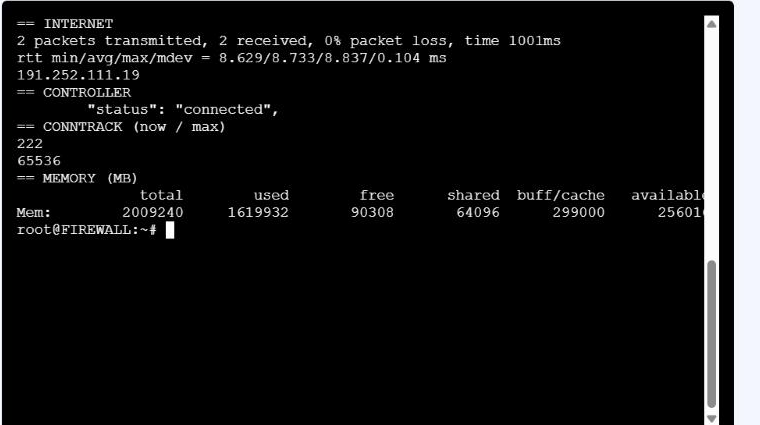

# KBA-0001: Health check in 5 minutes

**Symptom.** Something is wrong and you do not know where to start, or you want to confirm the unit is healthy after a change.

**Applies to.** Nexwall Firewall 26.2.1. Read-only: nothing here changes the configuration. Run it as `root` over SSH, the console or the remote terminal of the controller.

## Run it

Paste the whole block. It takes about five seconds.

```sh
echo "== TIME"; date; uptime
echo "== DISK"; df -h / /mnt/data 2>/dev/null
echo "== MEMORY (MB)"; free -m | head -2
echo "== LINKS"; ip -br a
echo "== DEFAULT ROUTE"; ip route | grep default
echo "== INTERNET"; ping -c2 -W2 8.8.8.8 | tail -2
echo "== DNS"; dig +short +time=3 +tries=1 nexwall.com.br
echo "== CONTROLLER"; ubus call ns.plug status | grep '"status"'
echo "== CONNTRACK (now / max)"; conntrack -C; cat /proc/sys/net/netfilter/nf_conntrack_max
echo "== CRITICAL ERRORS"; grep -iE 'out of memory|oom|segfault|panic' /var/log/messages | tail -3
```

Example output of a healthy unit:



## How to read the result

| Section | Healthy | If not |
|---|---|---|
| `DISK` | `/` below 85% used | Clean old logs and backups; see [Logs](../operation-analytics/logs.md). A full disk stops services. |
| `MEMORY` | `available` is more than 10% of `total` | A leak or too many features on a small unit. Check [Performance](../operation-analytics/performance.md). |
| `LINKS` | WAN and LAN are `UP` with an address | No address on the WAN: go to [KBA-0003](kba-03-no-internet.md). |
| `DEFAULT ROUTE` | One `default via` line per WAN | Missing: the WAN did not get a gateway. [KBA-0003](kba-03-no-internet.md). |
| `INTERNET` | 0% packet loss | Loss or no reply: [KBA-0003](kba-03-no-internet.md). |
| `DNS` | An IP address is printed | Empty: [KBA-0005](kba-05-dns.md). |
| `CONTROLLER` | `"status": "connected"` | Not connected: [Controller registration](controller-registration-troubleshooting.md). |
| `CONNTRACK` | "now" far below "max" | Close to max: a client is flooding connections; find it in [Connections](../operation-analytics/monitor-connections.md). |
| `CRITICAL ERRORS` | Nothing printed | Read the lines and send them with the [support package](kba-17-support-package.md). |

## Next step

Every line healthy but the problem persists? It is probably a single service or a single destination: use [KBA-0016](kba-16-services.md). Unsure? Collect the [support package (KBA-0017)](kba-17-support-package.md).
