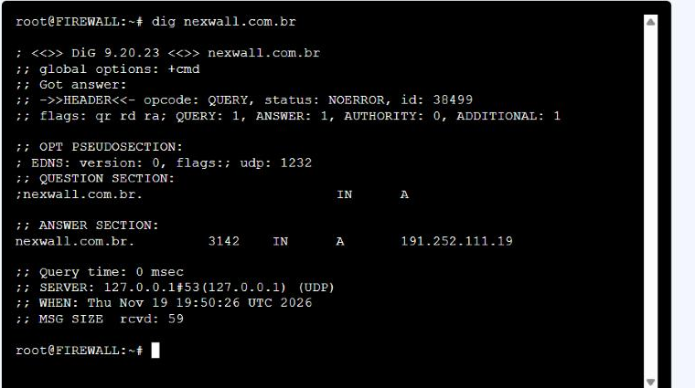
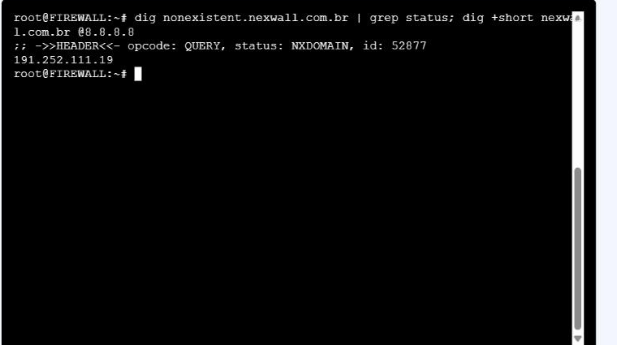

# KBA-15: Troubleshoot DNS from the command line

**Symptom.** A site or service "does not open", but pinging its IP address works. Or a name resolves from your
laptop and not from the LAN.

**Applies to.** Nexwall Firewall 26.2.1. Commands run as `root` over SSH, the console or the
[controller terminal](../administration/central-management.md).

:::note What is installed
`dig` and `nslookup` are installed and work out of the box. **`host` is not installed**, and neither is `telnet`
(see the [connectivity KBA](kba-14-connectivity.md) for the replacements). If a command says `not found`, check the
spelling and use `command -v <name>` before assuming a fault.
:::

## 1. Ask the unit's own resolver

```bash
dig nexwall.com.br
```

```text
;; ->>HEADER<<- opcode: QUERY, status: NOERROR, id: 60522
;; flags: qr rd ra; QUERY: 1, ANSWER: 1, AUTHORITY: 0, ADDITIONAL: 1

;; ANSWER SECTION:
nexwall.com.br.		3594	IN	A	191.252.111.19

;; Query time: 0 msec
;; SERVER: 127.0.0.1#53(127.0.0.1) (UDP)
```



*Screenshot: dig answered by the unit's own resolver, status NOERROR.*


Read three things: **`status`**, the **ANSWER SECTION** and the **SERVER** line. The server is `127.0.0.1`, the
resolver of the firewall itself (`dnsmasq`). For a short answer, add `+short`:

```bash
dig +short nexwall.com.br
```

| `status` | Meaning | Next step |
|---|---|---|
| `NOERROR` with an answer | The name resolves | The problem is not DNS, go to the [connectivity KBA](kba-14-connectivity.md) |
| `NOERROR` with **no** answer | The name exists but has no record of that type (for example, no `AAAA`) | Try `dig A <name>` and `dig AAAA <name>` |
| `NXDOMAIN` | The name does not exist | Check the spelling, then compare with a public resolver (step 2) |
| `SERVFAIL` | The upstream server could not answer | Test the upstream servers (step 3) |
| `communications error ... timed out` | The server did not answer at all | The resolver is down or unreachable (step 4) |

## 2. Compare with a public resolver

Ask a public server directly, bypassing the firewall's resolver:

```bash
dig +short nexwall.com.br @8.8.8.8
```

```text
191.252.111.19
```



*Screenshot: NXDOMAIN for a name that does not exist, and a public resolver answer for comparison.*


| Firewall resolver | Public resolver | Conclusion |
|---|---|---|
| Fails | Works | The problem is inside the firewall: `dnsmasq`, its upstream servers, or [DNS filtering](../security-services/dns-filtering.md) |
| Works | Works | DNS is fine; look at the client (its DNS setting, a cache, a VPN or a proxy on the PC) |
| Fails | Fails | The name really does not resolve, or the firewall has no internet. Check the WAN first |

[DNS filtering](../security-services/dns-filtering.md) can also change what a name resolves to, so a filtered
category looks like a DNS problem on the client. When one site fails and the rest work, compare the two answers and
check the filtering lists before looking elsewhere.

## 3. Check the upstream servers

The firewall forwards to the servers it received from the provider or that you set on the DNS & DHCP page.

```bash
cat /etc/resolv.conf
cat /tmp/resolv.conf.d/resolv.conf.auto
```

```text
search lan
nameserver 127.0.0.1
nameserver ::1
```

`/etc/resolv.conf` always points at the firewall itself. The servers it forwards to are in
`resolv.conf.auto`, one block per interface (here the WAN, whose gateway also acts as the resolver):

```text
# Interface wan
nameserver 192.168.0.1
search Home
```

Test each upstream server:

```bash
dig +short nexwall.com.br @<upstream-server> +time=3 +tries=1
```

A server that times out is the one to remove or replace. Two or more working servers avoid a single point of
failure.

## 4. A timeout: is the resolver reachable?

```bash
dig +short nexwall.com.br @10.255.255.1 +time=2 +tries=1
```

```text
;; communications error to 10.255.255.1#53: timed out
;; no servers could be reached
```

That is what an unreachable server looks like (the exit code is `9`). Next:

```bash
/etc/init.d/dnsmasq status
netstat -tulnp | grep ':53 '
```

```text
running
tcp   0   0 192.168.1.1:53   0.0.0.0:*   LISTEN   103916/dnsmasq
udp   0   0 192.168.1.1:53   0.0.0.0:*            103916/dnsmasq
```

If `dnsmasq` is not running, or nothing listens on the LAN address, restart it and read its log:

```bash
/etc/init.d/dnsmasq restart
grep dnsmasq /var/log/messages | tail -20
```

To check the configuration without restarting:

```bash
dnsmasq --test
```

```text
dnsmasq: syntax check OK.
```

## 5. Follow the resolution from the root

When the answer is wrong, or only some names fail, trace the whole path:

```bash
dig +trace nexwall.com.br
```

The trace goes from the root servers down to the authoritative ones. Lines such as
`UDP setup ... failed: network unreachable` for IPv6 addresses are normal on a network without IPv6; look at the last
line, which gives the final answer and where it came from.

## 6. Quick reference

| Task | Command |
|---|---|
| Resolve with the unit's resolver | `dig <name>` |
| Short answer only | `dig +short <name>` |
| A specific record type | `dig MX <name>`, `dig AAAA <name>`, `dig TXT <name>` |
| Use a specific server | `dig @1.1.1.1 <name>` |
| Reverse lookup | `dig -x <ip>` |
| Full path from the root | `dig +trace <name>` |
| Same with `nslookup` | `nslookup <name>` or `nslookup <name> <server>` |
| DNS over HTTPS | `dig +https @8.8.8.8 <name>` |
| Capture DNS traffic on the WAN | `tcpdump -i <wan-interface> -n udp port 53` |

## Related pages

- [KBA: Test connectivity, ports and traffic from the command line](kba-14-connectivity.md)
- [KBA: Verify and troubleshoot services from the command line](kba-16-services.md)
- [DNS and DHCP](../network/dns-dhcp.md)
- [DNS filtering](../security-services/dns-filtering.md)
- [Network troubleshooting tools](network-troubleshooting-tools.md)
