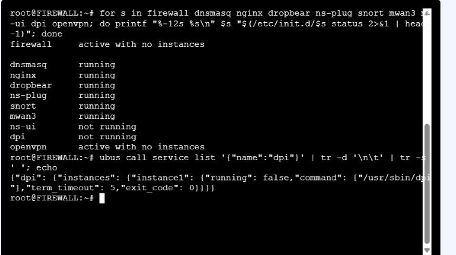

# KBA-16: Verify and troubleshoot services from the command line

**Symptom.** A feature of the firewall (DNS, VPN, IPS, web protection, the controller link) does not behave, and the
web interface does not say why.

**Applies to.** Nexwall Firewall 26.2.1. Commands run as `root` over SSH, the console or the
[controller terminal](../administration/central-management.md). Which service backs which feature is in the
[Service and log command reference](service-and-log-reference.md).

## 1. Ask the service for its status

```bash
/etc/init.d/dnsmasq status
```

```text
running
```

Check several at once:

```bash
for s in firewall dnsmasq nginx dropbear ns-plug snort mwan3 ns-ui dpi openvpn; do
  printf "%-12s %s\n" $s "$(/etc/init.d/$s status 2>&1 | head -1)"
done
```

```text
firewall     active with no instances
dnsmasq      running
nginx        running
dropbear     running
ns-plug      running
snort        running
mwan3        running
ns-ui        not running
dpi          not running
openvpn      active with no instances
```

## 2. How to read the answer

`not running` is **not always a fault**. The word depends on how the service is built:

| Answer | Meaning | Fault? |
|---|---|---|
| `running` | A long-lived process is alive | No |
| `active with no instances` | The service is enabled but has nothing to run, for example `openvpn` with no tunnel configured, or `firewall`, which only loads rules | No, unless you configured something that needs it |
| `not running` | No process is alive right now | **Depends**: a service that should stay up is stopped (fault), or it is a *run-once* service that did its job and exited (normal) |

`ns-ui`, `dpi` and `ns-binding` are run-once services in this version. Prove it by asking the service manager for the
details:

```bash
ubus call service list '{"name":"dpi"}'
```

```text
{ "dpi": { "instances": { "instance1": { "running": false, "command": [ "/usr/sbin/dpi" ], "exit_code": 0 } } } }
```



*Screenshot: status of ten services; ns-ui and dpi say "not running" yet exited normally (exit_code 0).*


`"running": false` with `"exit_code": 0` means the program finished normally. A real failure shows a non-zero
`exit_code`, or an instance that keeps restarting. Always confirm with the **effect**: a web interface that opens, or
a DPI block in the log, tells more than the word "running".

For a service that is running, the same call returns its `pid` and the exact command line, which shows which
configuration file it reads:

```bash
/etc/init.d/dnsmasq info
```

## 3. Is it enabled at boot?

```bash
/etc/init.d/dnsmasq enabled && echo yes || echo no
```

A service that works after you start it by hand and is gone after a reboot is not enabled. Use
`/etc/init.d/<service> enable`.

## 4. Is it listening, and does it answer?

```bash
netstat -tulnp | grep -E 'dnsmasq|dropbear|nginx'
```

```text
tcp   0.0.0.0:22         LISTEN   5645/dropbear
tcp   192.168.1.1:53     LISTEN   103916/dnsmasq
```

Then test the service from the network, as a client would: `nc -zv -w3 <ip> <port>` or `dig @<ip> <name>`. See the
[connectivity KBA](kba-14-connectivity.md).

## 5. Read its log

All services log to `/var/log/messages`, each under its own name (the `Find it in the log` column of the
[service reference](service-and-log-reference.md#services-by-feature)).

```bash
grep -i ns-plug /var/log/messages | tail -5
tail -f /var/log/messages | grep -i dnsmasq
```

The same search is available as one `ubus` call, which is what the **Logs** page of the web interface uses:

```bash
ubus call ns.log get-log '{"search":"dropbear","limit":2}'
```

```text
{ "values": [
    "Nov 19 19:45:08 FIREWALL.lan dropbear[102974]: Child connection from 192.168.0.8:52414",
    "Nov 19 19:45:08 FIREWALL.lan dropbear[102974]: Password auth succeeded for 'root' from 192.168.0.8:52414" ] }
```

Read the lines **around the moment of the failure**. Messages such as `EMSGSIZE Path-MTU=1420`, `refused`,
`timed out`, `failed` and `cannot` are the ones to start from. There is no `logread` on this unit; see
[Logs and debugging](cli-logs-and-debugging.md).

## 6. Check the configuration before restarting

A restart with a broken configuration turns a small problem into an outage. Validate first, where the service
allows it:

| Service | Check |
|---|---|
| `dnsmasq` | `dnsmasq --test` prints `syntax check OK.` |
| IPS (`snort`) | `snort-mgr check` validates the rendered configuration without applying it |
| Any UCI setting | `uci show <config>` shows what the service will read; see [Understanding UCI](understanding-uci.md) |

## 7. Restart or reload

```bash
/etc/init.d/firewall reload     # applies rules without dropping connections
/etc/init.d/dnsmasq restart     # short interruption
```

Try `reload` first where it exists. `restart` interrupts the service for a moment, so on a production unit do it
when it is acceptable. Do not restart `keepalived` directly on a high-availability pair; use `ns-ha-config`.
Afterwards repeat steps 1 and 4, then read the log again.

## 8. Feature-specific status

When the generic checks pass and the feature still misbehaves, the feature has its own status command:

| Feature | Command |
|---|---|
| Controller link | `ubus call ns.plug status` |
| SD-WAN | `mwan3 status` |
| WireGuard | `wg show` |
| IPsec | `swanctl --list-sas` |
| IPS | `snort-mgr status` |
| High availability | `ns-ha-config status` |

```bash
ubus call ns.plug status
```

```text
{
	"status": "connected",
	"address": "10.103.0.2",
	"server": "https://cloud.nexwall.com.br",
	"unit_name": "Nexwall-LAB-FW"
}
```

## 9. Low memory is a common hidden cause

Services are stopped by the system when memory runs out, and the filtering features (IPS, DNS filtering, web
protection) are the largest consumers.

```bash
free
snort-mgr status
```

```text
              total        used        free      shared  buff/cache   available
Mem:        2009240     1254832      184416       68744      569992      612240
Total system memory=1962.148M  Used=1786.797M (91.1%)  Free=175.352M (8.9%)
```

The values are in kilobytes. If `available` is very low, or services restart without an obvious reason, look for out-of-memory lines with
`grep -i "out of memory\|oom" /var/log/messages | tail`, and consider turning off the lists or features you do not
need. The DNS filtering page shows how much memory the active lists need.

## Quick reference

| Question | Command |
|---|---|
| Is it running? | `/etc/init.d/<svc> status` |
| Really? Exit code, pid, command | `ubus call service list '{"name":"<svc>"}'` |
| Enabled at boot? | `/etc/init.d/<svc> enabled` |
| Listening? | `netstat -tulnp \| grep <svc>` |
| What does the log say? | `grep -i <svc> /var/log/messages \| tail -20` |
| Restart | `/etc/init.d/<svc> restart` |
| All services on this unit | `ls /etc/init.d` |

## Related pages

- [KBA: Troubleshoot DNS from the command line](kba-15-dns-deep-dive.md)
- [KBA: Test connectivity, ports and traffic from the command line](kba-14-connectivity.md)
- [Service and log command reference](service-and-log-reference.md)
- [Logs and debugging from the command line](cli-logs-and-debugging.md)
