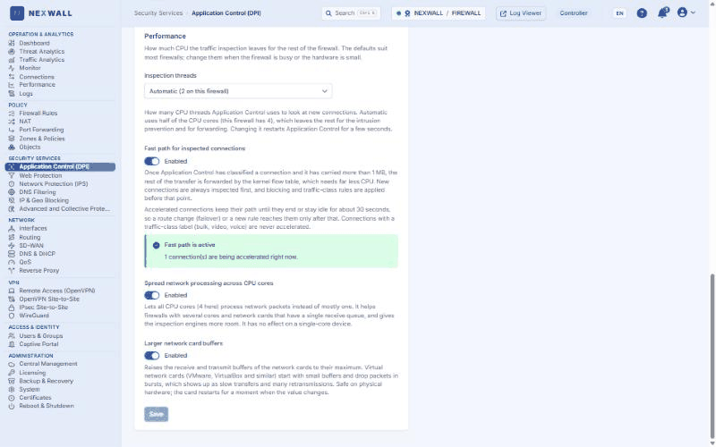
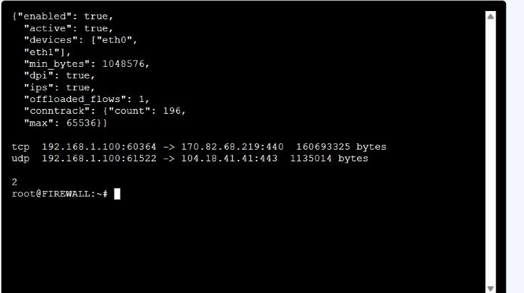

# KBA-0018: Fast path (flow offload): commands, status and troubleshooting

**Applies to.** Nexwall Firewall 26.2.1 (commands checked on it).

## What it is

Both inspection engines look only at the start of a connection: DPI at the first 32 packets, the IPS up to its inspection
depth (1 MiB by default). After that the rest of a long transfer only needs to be forwarded. The **fast path** hands such
connections to the kernel's software flow table, which forwards their packets without walking routing, NAT and the firewall
hooks again. It uses much less CPU on long downloads, backups and video, and leaves more room for signatures.

It is **not** the stock firewall switch "Software flow offloading": that one offloads every connection right after the
handshake and would hide the start of every connection from DPI and the IPS. The Nexwall fast path offloads a connection only when

- it is established, has carried more than the threshold (the IPS inspection depth while the IPS runs, at least 256 KiB, and
  more than 32 packets), and
- when DPI runs: the engine has marked it `netify-analyzed` and it has no traffic-class label (`bulk`, `best_effort`, `video`,
  `voice`) and is not `netify-blocked`.

Everything lives in its own nftables table, `inet nexwall_fastpath`. Removing it puts every connection back on the normal path.
Any error also leaves traffic on the normal path.

## Turn it on or off


*Application Control > Settings: performance options*

UI: **Application Control (DPI) > Settings > Performance** or **Network Protection (IPS) > Settings > Performance**
(one switch for both), then Save and apply the pending changes.

Command line:

```sh
uci set nexwall_perf.main.fastpath=1      # 0 to turn it off
uci commit nexwall_perf
/etc/init.d/nexwall-fastpath reload       # applies it now (also happens on the next config reload)
```

Related setting handled by the same tool: `nexwall_perf.main.ring_buffers` (`1` raises the NIC rings to their maximum at apply time, independent of the fast path; see [KBA-0019](kba-19-inspection-settings.md)).

Optional: `uci set nexwall_perf.main.min_bytes=2097152` raises the threshold (default `auto`; values below 262144 are raised to it).

## Commands


*Output of nexwall-fastpath status and list*

| Command | What it does |
|---|---|
| `nexwall-fastpath status` | One JSON line: `enabled`, `active`, `devices`, `min_bytes`, `dpi`, `ips`, `offloaded_flows`, and `reason`/`error` when it is not active |
| `nexwall-fastpath list` | The connections on the fast path right now, biggest first: protocol, source, destination, bytes |
| `nexwall-fastpath apply` | Reads the settings and (re)builds the table; this also flushes the flow table, so every connection is judged again with the current rules |
| `nexwall-fastpath stop` | Removes the table immediately (the setting stays as it is) |
| `/etc/init.d/nexwall-fastpath start \| reload \| stop` | The same through the service; it re-applies on changes of `nexwall_perf`, `dpi`, `snort`, `network` and on interface up/down |

Example:

```sh
# nexwall-fastpath status
{"enabled": true, "active": true, "devices": ["eth0", "eth1"], "min_bytes": 1048576, "dpi": true, "ips": true, "offloaded_flows": 3}

# nexwall-fastpath list
tcp  192.168.1.242:3350 -> 162.159.140.220:443  103919398 bytes
```

## Where to see offloaded traffic

- **UI:** the Performance card shows "Fast path is active" and how many connections are accelerated (refreshed every 15 s).
- **Connection tracker:** accelerated connections carry the `[OFFLOAD]` flag and their byte counters keep counting:

```sh
grep OFFLOAD /proc/net/nf_conntrack
conntrack -L 2>/dev/null | grep OFFLOAD
```

- **Rules and counters:** `nft list table inet nexwall_fastpath` (flow table devices, the label rules, the offload rule).
- **System log:** every apply, stop and failure is logged with the tag `nexwall-fastpath`:

```sh
grep nexwall-fastpath /var/log/messages
```

## Reading `status`

| `reason` | Meaning | What to do |
|---|---|---|
| `disabled` | The switch is off | Nothing, or turn it on |
| `not-applied` | The setting is on but nothing was applied yet | `/etc/init.d/nexwall-fastpath start` (it registers the triggers) then `reload` |
| `no-devices` | No up interface was found to put in the flow table | Check `ubus call network.interface dump`; fix the interface, then `nexwall-fastpath apply` |
| `error` | `nft` refused the ruleset (`error` has the message) | Check the kernel modules `nf_flow_table`, `nft_flow_offload`; send the message to support |

`offloaded_flows` of 0 while the switch is on is normal until a connection has passed the threshold **and** DPI has analyzed
it. A short web page never reaches the fast path.

## Things to know

- An accelerated connection keeps its path until it ends or is idle for about 30 seconds. A route change (WAN failover) or a
  new firewall/DPI rule therefore reaches it only after that. `nexwall-fastpath apply` (also run after every DPI reload)
  flushes the flow table so everything is judged again.
- Connections with a traffic-class label (bulk, video, voice from DPI QoS rules) are never accelerated, because the DSCP
  marking is done by a hook that offloaded packets skip.
- The flow table has the `counter` option: byte and packet counters of accelerated connections stay current, so traffic
  statistics and accounting keep working. (Without it the counters would freeze at the offload point.)
- Tunnels (OpenVPN, WireGuard, IPsec) are not put in the flow table; their traffic is not accelerated.
- SQM / traffic shaping on the interface still applies (it works at the queue discipline, after forwarding).
- In lab tests (virtual firewall) the fast path gave about 10% more throughput and about 10% less CPU per Gbit/s; the larger gains came from packet steering and bigger NIC buffers. See [KBA-0020](kba-20-throughput-sizing.md). Measure on your hardware.

## Quick checks when something looks wrong

```sh
nexwall-fastpath status
nft list table inet nexwall_fastpath | head -30
grep -c OFFLOAD /proc/net/nf_conntrack
grep nexwall-fastpath /var/log/messages | tail
/etc/init.d/nexwall-fastpath status
```

To rule the fast path out as the cause of a problem, turn it off and test again:

```sh
uci set nexwall_perf.main.fastpath=0; uci commit nexwall_perf; nexwall-fastpath stop
```

## What to collect before contacting support

1. `nexwall-fastpath status`, `nexwall-fastpath list | head`, `nft list table inet nexwall_fastpath`.
2. `grep nexwall-fastpath /var/log/messages`.
3. `uci show nexwall_perf; uci show dpi.engine; uci show snort.nfq`.
4. The affected client and server addresses and the time, so the connection can be found in `nexwall-fastpath list`.
