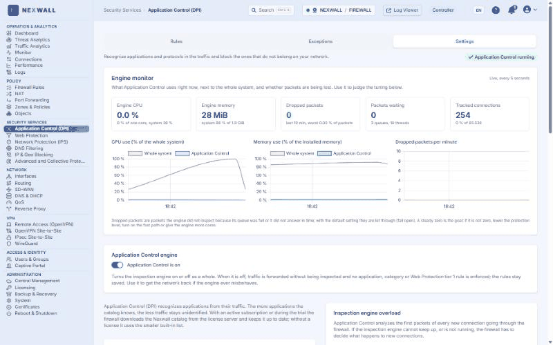

# KBA-0020: Throughput, CPU and memory: how to measure and size

Use this when the firewall is slow under inspection, drops packets in bursts, or you need to size a new unit. Settings are explained in [KBA-0019](kba-19-inspection-settings.md).

**Applies to.** Nexwall Firewall 26.2.1.

## How to check the effect


*Engine monitor: CPU, memory, dropped packets and tracked connections*

```sh
dpidbg status                                    # DPI queues: waiting packets and verdict counters
cat /proc/net/netfilter/nfnetlink_queue          # queues 50-5x DPI, 4-7 IPS: column 6 = dropped when the queue was full
top -b -n1 | head -15                            # who uses the CPU
nexwall-fastpath status                          # fast path state and accelerated connection count
nexwall-ips-rules status                         # signature bundle, policy, last check
ls /var/log/snort                                # IPS alerts (JSON)
```

Queue columns: `queue_total` (waiting now) should stay near 0; a growing `queue_dropped` means the engine cannot keep up:
lower the IPS level, enable the fast path, or give the engines more cores.


## Starting points by hardware

| Hardware | DPI threads | IPS level | Fast path | Packet steering | Larger buffers |
|---|---|---|---|---|---|
| 1-2 cores | Automatic (1) | Connectivity | On | On (2 cores) | On |
| 4 cores | Automatic (2) | Balanced | Optional (about +10% on long transfers in the lab) | On (a single-queue or virtual NIC loses most of its speed without it) | On |
| 8+ cores | Automatic (4) | Balanced or Security | On | Usually not needed on multi-queue NICs | On for virtual NICs |

These are starting points. Change one setting at a time and compare.


## Connection table and memory

Every tracked connection costs about 5.6 KB (kernel, DPI and IPS together, measured with 77,000 connections), so the
connection limit is derived from the installed memory: 32 entries per MiB, at least 65,536 (2 GiB: 65,536, 4 GiB: 131,072,
8 GiB: 253,952, 16 GiB: 524,288). `nexwall-fastpath apply` sets it at boot and on reload (`nexwall_perf.main.conntrack_auto=0`
keeps a manual `net.netfilter.nf_conntrack_max`). The kernel's own default (about 1,000,000 entries on 8 GiB) would let the
engines use more memory than a small firewall has: the lab firewall stopped answering when the table grew far beyond what
its 2 GiB could hold. Watch **Tracked connections** in the Engine monitor; if it stays near 100 % the limit is too low for
the number of users and more memory is the answer, not a bigger table.

IPS queues and threads follow the number of CPU cores (up to 16) automatically (`snort.nfq.cpu_auto=0` keeps a manual value);
each extra thread adds about 15 MB of memory.


## Lab measurements (virtual firewall, 4 vCPU, e1000)

Client VM through the firewall to a server VM, iperf3, 4 TCP streams, reverse direction, 3 x 10 s per line (Mbit/s, mean):

| Configuration | Result |
|---|---|
| Direct between the two VMs (no firewall) | about 2,700 |
| Firewall, no DPI/IPS, default NIC rings, no steering | 17 to 120, thousands of retransmissions |
| same, rings at maximum | 100, one retransmission |
| rings at maximum + packet steering | 694 |
| + DPI and IPS on (balanced) | 736 |
| + fast path | 740 to 890 (two A/B pairs: fast path 866 and 920 Mbit/s at 60 and 52 CPU % per Gbit/s, off 840 and 758 at 60 and 65) |

Reading: on this virtual NIC the first limit was the ring size (UDP at 300 Mbit/s lost 53% with 256 descriptors, 0.3% with 4096),
the second the single interrupt that kept one core at 100% (steering moved the load: 100 to about 700 Mbit/s). With those two
fixed, DPI and IPS cost little for large transfers, because they only inspect the first 32 packets / 1 MiB of each connection,
and the fast path gave about 10% more throughput for about 10% less CPU per Gbit/s (inside the noise of a shared host).
Many small connections (3,000 short HTTP requests, 60 in parallel): about 155 requests/s with DPI and IPS on against 163 to 184 without
(the test server was the limit). Absolute numbers depend on the hypervisor; use them to compare settings, not as product specifications.
