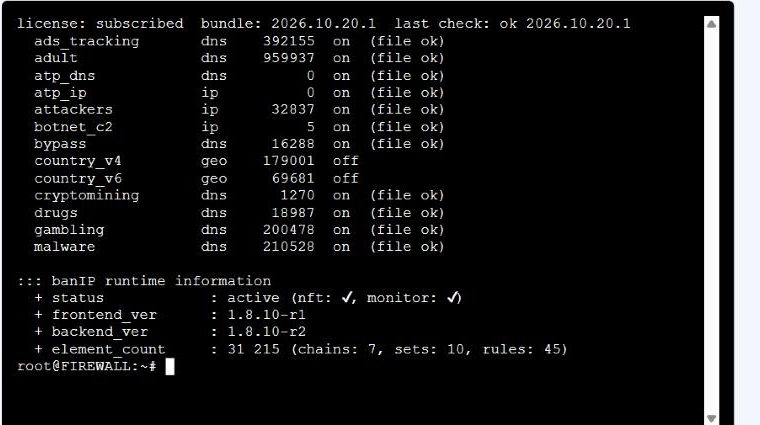

# KBA-0023: Threat Shield lists: check and troubleshoot

**Applies to.** Nexwall Firewall 26.2.1. How the lists work and their memory cost: [KBA-0024](kba-24-threat-shield-lists.md).

## Troubleshooting

**No lists / "not licensed".** `nexwall-threat-feeds status` shows `license: unlicensed` or `last check: not licensed`. Register the firewall or ask for a trial; check `licensectl state`.

**"update failed".** `status` shows the reason. Typical: the firewall cannot reach the licence server (check `licensectl state`), or a file did not match its signed hash (retry
with `--force`; if it repeats, send the message to support). A failed update never removes the lists already on the firewall.

**Category switched on but not blocking.** `status` must show `(file ok)` for it; if not, run `nexwall-threat-feeds sync`. Then `/etc/init.d/adblock status` must list it under active feeds.
Test: `nslookup <listed domain> 127.0.0.1` answers NXDOMAIN. A client that uses its own DNS (DoH, a fixed 8.8.8.8) bypasses the filter unless DNS enforcement is on
(Threat Shield > DNS filtering > Settings: ports 53 and 853 are redirected to the firewall).

**A site is blocked that must work.** Add the domain to the DNS allowlist (Threat Shield > DNS filtering > Allowlist). Report it to support with the category: false positives are fixed in the
daily build (the build has its own allowlist of critical domains).

**banIP shows "processing" for minutes.** banIP downloads the feeds one by one. The Nexwall IP lists are local and take seconds; the slow part is geo-blocking
(`country` feed, one download per country, from a third party) and any feed of banIP's own list that is switched on. Check `grep banIP /var/log/messages`.

**DNS stops answering for a moment after a change.** dnsmasq restarts to load the lists (see [KBA-0024](kba-24-threat-shield-lists.md#memory-and-speed)). If it lasts minutes the lists are too large for the memory: switch off the biggest categories.

## Commands

*Output of nexwall-threat-feeds status and banIP status*

| Command | What it does |
|---|---|
| `nexwall-threat-feeds status` | licence state, bundle version, last check, every category with entries, on/off and whether its file is on the firewall |
| `nexwall-threat-feeds status --json` | the same for scripts; includes the estimated DNS memory of the switched-on lists (`dns_memory_mib`) |
| `nexwall-threat-feeds update [--force]` | check the server and download what is switched on (does not touch adblock or banIP) |
| `nexwall-threat-feeds sync` | update, then reload adblock and banIP if something changed (what cron runs) |
| `nexwall-threat-feeds feeds-dns` / `feeds-ip` | the feed definitions handed to adblock / banIP (called by `ts-dns` / `ts-ip`) |
| `/etc/init.d/adblock status` | blocked domains, active feeds, dnsmasq memory |
| `/etc/init.d/banip status` | elements in the IP sets, active feeds |

Files: `/mnt/data/threat-feeds/` (catalog `manifest.json`, `state.json`, one folder per version, the two newest are kept),
`/etc/adblock/adblock.custom.feeds`, `/etc/banip/banip.custom.feeds`. Log: `grep nexwall-threat-feeds /var/log/messages`.

## What to collect before contacting support

`nexwall-threat-feeds status --json`, `/etc/init.d/adblock status`, `/etc/init.d/banip status`, `uci show adblock.global`, `uci show banip.global | grep -v oinkcode`,
`grep -E "nexwall-threat-feeds|adblock|banIP" /var/log/messages | tail -50`, `free -m`, and the name of the domain or address that is wrongly blocked or not blocked.
