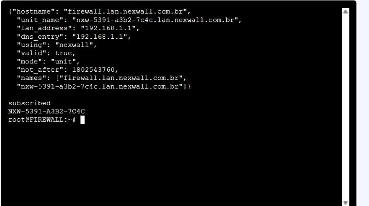

# KBA-0025: Web interface address and certificate

Applies to firmware 26.0.0-rc4 and later. Firmware up to rc3 uses a shared certificate for `firewall.nexwall.com.br` (see the last section).

## What to type

| Address | Result |
|---|---|
| `https://firewall.lan.nexwall.com.br` | the web interface, **with a certificate the browser trusts** (no warning). This is the address on the label. |
| `https://<serial>.lan.nexwall.com.br` | the same, by the serial number of the unit in lower case, for example `https://nxw-5391-a3b2-7c4c.lan.nexwall.com.br`. |
| `http://192.168.1.1` (or the LAN address you configured), `http://firewall.lan` | a small page that opens the trusted address, or shows the direct link if the computer cannot reach it. |
| `https://192.168.1.1`, `https://firewall.lan` | the web interface, but the browser **warns about the certificate**: no public authority issues certificates for private addresses. Accept the warning once or use the trusted address. |

## How it works

1. The firewall answers the two names above itself: its DNS server returns the LAN address of the unit. The computer must therefore **use the firewall as its DNS
   server** (the default when the computer gets its address from the firewall by DHCP).
2. The unit makes a private key of its own (it never leaves the unit) and asks the Nexwall license server for a certificate for its two names. The server
   asks Let's Encrypt, which validates the names through DNS, and the unit installs the answer after checking the signature of the server, the names and its key.
3. This starts a few minutes after the first registration with the license server (internet and a registered unit are needed) and is checked every 30 minutes;
   the certificate is renewed automatically 28 days before it ends (it is valid for 90 days).
4. Until a valid certificate is installed, and whenever it stops being valid, the web interface keeps (or goes back to) its own self-signed certificate, so it is
   always reachable by the direct address.

## Commands (on the firewall)

*Output of nexwall-webui-cert status, licensectl state and the serial number*

| Command | What it does |
|---|---|
| `nexwall-webui-cert status` | what is in use: `using` (`nexwall` or `self-signed`), `valid`, `mode` (`unit` = the certificate of this unit, `shared` = the shared one of older firmware, `none`), names, expiry (epoch seconds) |
| `nexwall-webui-cert sync` | do it now: DNS entries, then request/renew the certificate (up to about 2.5 minutes while the validation runs) |
| `nexwall-webui-cert dns` | only the DNS entries (after the LAN address was changed) |
| `nexwall-webui-cert revert` | back to the self-signed certificate |
| `grep nexwall-webui-cert /var/log/messages` | what happened on the last runs |

Check from a computer: `nslookup firewall.lan.nexwall.com.br 192.168.1.1` must answer `192.168.1.1`.

## Troubleshooting

| Symptom | Cause | What to do |
|---|---|---|
| The browser warns on `https://192.168.1.1` | expected for an address, not a name | use `https://firewall.lan.nexwall.com.br` |
| "This site can't be reached" / `ERR_NAME_NOT_RESOLVED` for the trusted name | the computer does not use the firewall as DNS server (fixed DNS such as 8.8.8.8, a VPN, "secure DNS" in the browser, another router in front) | set the computer to get DNS from the firewall, or turn off the browser's secure DNS; test with the `nslookup` above. Meanwhile use `http://192.168.1.1`, which shows the direct link |
| The port 80 page says the secure address could not be reached | same cause | same |
| The trusted name opens but the browser still warns (self-signed certificate) | no own certificate installed yet: `nexwall-webui-cert status` shows `using: self-signed` | wait for the next run or run `nexwall-webui-cert sync`; read the log lines; see the rows below |
| `could not get the own certificate: ... HTTP 401` or `DEVICE_ALREADY_REGISTERED` | the unit is not registered with the license server | see [KBA-0026](kba-26-licensing.md): reseller **Reset device**, then **Synchronize** on the unit |
| `could not get the own certificate: request failed` / timeout | no internet or no DNS on the firewall | check the WAN; `nslookup license.nexwall.com.br` on the firewall |
| `the certificate is still being issued, the next run asks again` | the validation takes longer than 2.5 minutes | nothing, the next run (30 minutes) finishes it |
| `ISSUE_FAILED` with a text | Let's Encrypt or the validation failed this time | the server tries again after 15 minutes; if it repeats for hours send the text to support |
| `RATE_LIMIT` | this unit asked for more than 4 new certificates in a week (typically after several factory resets: every reset makes a new key) | wait a week or ask support |
| `NAMES` or `UNIT_SERIAL` | the serial number of the unit is missing or changed | `cat /etc/nexwall-license/serial` must show `NXW-XXXX-XXXX-XXXX`; register the unit again ([KBA-0026](kba-26-licensing.md)) |
| `ERR_CERT_DATE_INVALID` or "certificate not yet valid" | the clock of the computer or of the firewall is wrong | set the time on both; on the firewall `date` and the NTP settings |
| The name stopped working after the LAN address was changed | the DNS entries point to the old address | `nexwall-webui-cert dns` (it also happens by itself within 30 minutes) |
| Another DNS server in front blocks the name ("DNS rebinding protection") | a private address in an answer for a public name is dropped | allow `lan.nexwall.com.br` as a private domain on that DNS server, or let the computers ask the firewall |
| The web interface does not open at all after a certificate change | the web server did not accept the new files | the tool goes back to the self-signed certificate by itself; if not: `nexwall-webui-cert revert` |

## Good to know

- Every unit has a different certificate and key. A factory reset (or reinstall) makes a new key and a new certificate request.
- The certificates are issued by Let's Encrypt; the names `firewall.lan.nexwall.com.br` and the serial name are public names in the certificate transparency logs
  (they contain the serial number of the unit, no other data).
- Older firmware (up to 26.0.0-rc3): `https://firewall.nexwall.com.br` with one shared certificate, nothing to configure. The newer firmware keeps using it
  only as a fallback.
