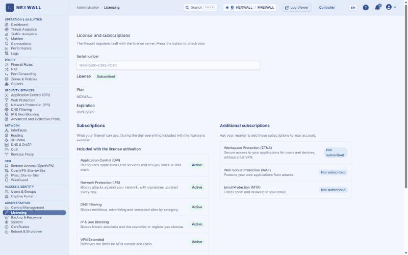

# KBA-0026: Licensing, subscriptions and registration

**Applies to.** Nexwall Firewall 26.0.0 and later (commands checked on 26.2.1).

## How a firewall gets its license

1. The firewall registers itself: the license component checks in with the license server (`https://license.nexwall.com.br`) after the first
   start, once the network is up, and then every 15 minutes. No code is typed. The unit appears in the panel as **unassigned**, with its serial number (`NXW-XXXX-XXXX-XXXX`).
2. It starts in a **trial of 30 days** (the panel can extend it, as many times as needed). During the trial the five base modules are available:
   Application Control (DPI), Network Protection (IPS), DNS Filtering, IP & Geo Blocking and VPN Extended.
3. The reseller assigns the serial number to a partner in the panel and applies the subscription (below). Only then the unit becomes **Subscribed**.
   Being assigned to a partner is not enough.
4. The signed license (a lease of 14 days, renewed at each check-in) lists the modules. Web Server Protection (WAF) and Email Protection (MTA) are separate
   add-ons: they show as "Not subscribed" and their features are not available yet.

## Panel (license server)

*Administration > Licensing*

| Task | Where |
|---|---|
| Subscribe a partner to the five base modules | Partner page, **Activate license** |
| Subscribe or remove one module (with its own end date) | Partner page, table **Modules & Subscriptions**, **Save subscriptions** |
| Assign a unit | Firewalls page, **Assign to...** |
| Extend the trial | Firewalls page, **Extend trial +30d** |
| Let a reinstalled unit register again | Firewalls page, **Reset device** |

## On the firewall

Licensing page: serial number, the state (Trial with the days left, Subscribed, Unlicensed), the subscriptions (active / not active, base modules and
additional ones) and the button **Synchronize with server**. From the command line: `ubus call ns.subscription info`, `ubus call ns.subscription sync`,
`licensectl state`, `licensectl entitlements`.

## Troubleshooting

| Symptom | Cause | What to do |
|---|---|---|
| The page says the firewall has not talked to the server yet | no internet yet, or the first check-in has not run | press **Synchronize with server**; check the WAN and DNS |
| "already registered ... ask your reseller to reset the device" (`DEVICE_ALREADY_REGISTERED`) | the unit was reinstalled and the server still holds its old device token | reseller: Firewalls page, **Reset device**, then press **Synchronize** on the unit |
| IPS, DNS lists or application catalog fail with HTTP 401 | same as above: no valid device token | same as above |
| Trial although the unit is assigned | the partner has no running module subscription | **Activate license** on the partner page |
| A module shows "Not active" | the partner has no subscription for it, or it expired | Partner page, subscriptions |

The trial that a unit gets without any contact with the server (first 24 hours) is only a bootstrap: after it the unit is unlicensed until it has talked to the server.
