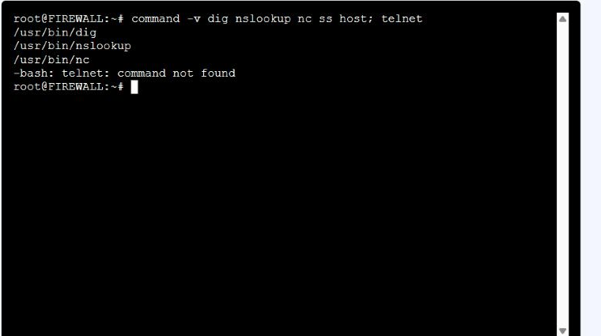
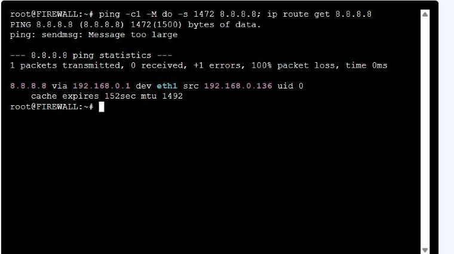
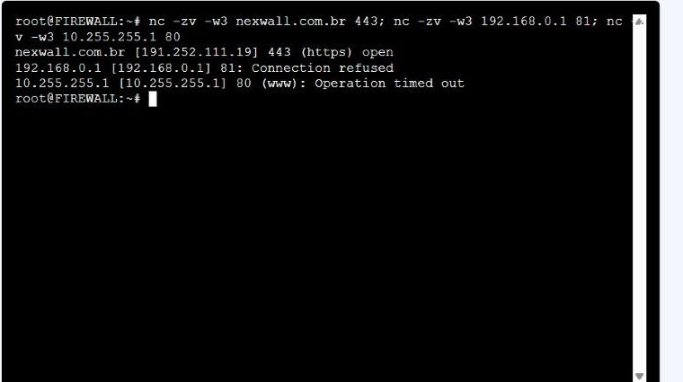
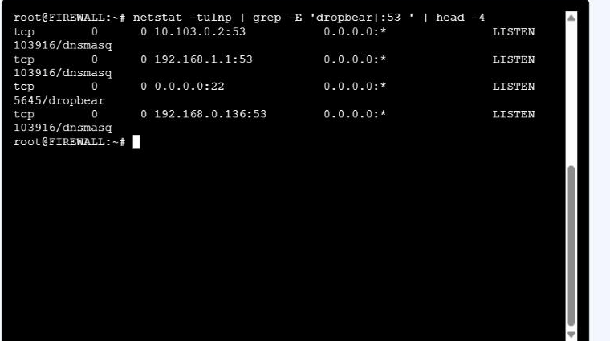

# KBA: Test connectivity, ports and traffic from the command line

**Symptom.** A user cannot reach a server, a published service does not answer, or a VPN is slow or drops large
packets.

**Applies to.** Nexwall Firewall 26.2.1. Commands run as `root` over SSH, the console or the
[controller terminal](../administration/central-management.md).

## Tools that are not installed

This image is small on purpose. Some familiar tools are missing; use the replacement.

| Missing | Use instead |
|---|---|
| `telnet` | `nc -zv <host> <port>` to test a port, or `nc <host> <port>` to open a raw connection and talk to it |
| `ss` | `netstat -tulnp` (listening ports and the process behind each) |
| `host` | `dig` or `nslookup` (see the [DNS KBA](kba-cli-dns.md)) |
| `mtr` | `traceroute -n <host>` |

Installed and ready: `ping` (the full version, with `-M do -s`), `traceroute`, `nc`, `curl`, `wget`, `openssl`,
`tcpdump`, `netstat`, `lsof`, `fuser`, `conntrack`, `arping`, `arp-scan`, `ethtool`, `bwm-ng`, `dig`, `nslookup`.

`speedtest` (SpeedTest++, a WAN speed test: download, upload and latency) is installed as well. `iperf3` and `nmap` are not part of the image, and you do not need to install anything to follow this article.



*Screenshot: dig, nslookup and nc are installed; telnet, ss and host are not.*


## 1. Link and addresses

```bash
ip -br a
ip route
```

```text
eth1       UP    192.168.0.136/24
br-lan     UP    192.168.1.1/24
tun-nsplug UNKNOWN 10.103.0.2/16

default via 192.168.0.1 dev eth1 proto static src 192.168.0.136 metric 20
192.168.1.0/24 dev br-lan proto kernel scope link src 192.168.1.1
```

Check that the interface is `UP` and has the address you expect, and that there is a `default` route. A tunnel
interface such as `tun-nsplug` (the controller link) shows `UNKNOWN`, which is normal for tunnels.
If the link itself is suspect, `ethtool <interface>` shows speed and the detected link.

## 2. Reachability and path

```bash
ping -c3 8.8.8.8
```

```text
3 packets transmitted, 3 received, 0% packet loss, time 2004ms
rtt min/avg/max/mdev = 10.256/11.931/12.869/1.187 ms
```

```bash
traceroute -n -m5 -w1 8.8.8.8
```

```text
 1  192.168.0.1  3.870 ms  3.572 ms  5.708 ms
 2  *  *  *
 3  ...
```

`* * *` on a hop is common: many routers do not answer probes. What matters is whether the later hops answer. If the
trace stops at the first hop, the problem is the next device or the link. To confirm who is on the local segment,
use `ip neigh`, or `arping -I eth1 <ip>`.

## 3. MTU: the packet that is too large

Large packets that disappear while small ones pass are the classic MTU symptom, most often across VPNs and PPPoE
links. Send a packet that must not be fragmented:

```bash
ping -c1 -M do -s 1472 8.8.8.8
```

```text
PING 8.8.8.8 (8.8.8.8) 1472(1500) bytes of data.
ping: sendmsg: Message too large
```

`1472` plus 28 bytes of headers is 1500. "Message too large" here means the path to that destination allows less.
Ask the kernel what it learned:

```bash
ip route get 8.8.8.8
```

```text
8.8.8.8 via 192.168.0.1 dev eth1 src 192.168.0.136 uid 0
    cache expires 571sec mtu 1492
```



*Screenshot: a 1500-byte packet that does not fit, and the path MTU of 1492 learned by the kernel.*


The path MTU is **1492**, typical of a PPPoE upstream. A smaller size gets through:

```bash
ping -c1 -M do -s 1400 8.8.8.8
```

Lower the size step by step until it passes; the largest size that passes plus 28 is the usable MTU. In the same
way, the controller link logs the value it was told: `grep Path-MTU /var/log/messages | tail -3` shows lines such
as `EMSGSIZE Path-MTU=1420`.

## 4. Is the port open? (replacing telnet)

```bash
nc -zv -w3 nexwall.com.br 443
```

```text
nexwall.com.br [191.252.111.19] 443 (https) open
```

The three possible outcomes tell you where to look:

| Result | Meaning | Where to look |
|---|---|---|
| `open` | Something answered | The network path is fine, look at the application |
| `Connection refused` | The destination replied that nothing listens | The service is stopped, or on another port |
| `Operation timed out` | No reply at all | A firewall rule, a missing route or a dead host is dropping the traffic |

```bash
nc -zv -w3 192.168.0.1 81
nc -zv -w3 10.255.255.1 80
```

```text
192.168.0.1 [192.168.0.1] 81: Connection refused
10.255.255.1 [10.255.255.1] 80 (www): Operation timed out
```



*Screenshot: the three results of nc -zv: open, Connection refused and Operation timed out.*


To check a web service end to end, and a certificate:

```bash
curl -sI --max-time 6 https://nexwall.com.br | head -3
echo | openssl s_client -connect nexwall.com.br:443 -servername nexwall.com.br 2>/dev/null | grep -E "subject=|issuer=|Verify return|Protocol"
```

```text
HTTP/1.1 200 OK
subject=CN=nexwall.com.br
issuer=C=US, O=Let's Encrypt, CN=YE1
Protocol: TLSv1.3
Verify return code: 0 (ok)
```

## 5. What is listening on the firewall?

```bash
netstat -tulnp
```

```text
Proto Local Address          State    PID/Program name
tcp   0.0.0.0:443            LISTEN   52552/uci.conf
tcp   0.0.0.0:22             LISTEN   5645/dropbear
tcp   192.168.1.1:53         LISTEN   103916/dnsmasq
udp   192.168.1.1:53                  103916/dnsmasq
```



*Screenshot: netstat -tulnp showing dropbear on port 22 and dnsmasq on port 53.*


Use it to confirm that a service is bound to the interface you expect (`127.0.0.1` means local only, `0.0.0.0` means
every interface). To see who holds one port, `lsof -i :443`.

## 6. Watch the packets

```bash
tcpdump -i eth1 -n -c 6 'udp port 53 or icmp'
```

```text
19:44:29.645520 IP 8.8.8.8 > 192.168.0.136: ICMP echo reply, id 37053, seq 1, length 64
19:44:30.003115 IP 192.168.0.136 > 1.1.1.1: ICMP echo request, id 37056, seq 1, length 24
```

Capture on the LAN side and on the WAN side of the same flow: the source address (and often the port) should differ,
which proves that NAT is working. Add `-w /tmp/capture.pcap` to save a file for Wireshark, and always limit the capture
with a filter or `-c`, because `/tmp` is in memory and a long capture fills it.

## 7. Is the connection tracked?

```bash
conntrack -C
conntrack -L -d 8.8.8.8 | head -3
```

```text
381
udp 17 10 src=192.168.0.136 dst=8.8.8.8 sport=40102 dport=53 ... src=8.8.8.8 dst=192.168.0.136 sport=53 dport=40102 ...
udp 17 40 src=192.168.0.136 dst=8.8.8.8 sport=49943 dport=33440 ... [UNREPLIED] ...
```

The first number is the count of tracked connections. An entry marked **`[UNREPLIED]`** left the firewall and has not
received an answer yet. If every attempt to one destination stays `UNREPLIED`, the problem is beyond the firewall.
If the connection does not appear at all, it was dropped before tracking: check the firewall rules and the log.

## Quick reference

| Question | Command |
|---|---|
| Is the interface up, which address? | `ip -br a` |
| Is there a default route? | `ip route` |
| Where would traffic to X go? | `ip route get <ip>` |
| Is X alive? | `ping -c3 <ip>` |
| Where does the path stop? | `traceroute -n <ip>` |
| Is the port open? | `nc -zv -w3 <host> <port>` |
| What listens here? | `netstat -tulnp` |
| What do the packets look like? | `tcpdump -i <if> -n host <ip>` |
| Is it tracked and NATed? | `conntrack -L -d <ip>` |
| WAN speed (download, upload, latency) | `speedtest` |

## Related pages

- [KBA: Troubleshoot DNS from the command line](kba-cli-dns.md)
- [KBA: Verify and troubleshoot services from the command line](kba-cli-services.md)
- [Network troubleshooting tools](network-troubleshooting-tools.md)
- [Monitor connections](../operation-analytics/monitor-connections.md)
