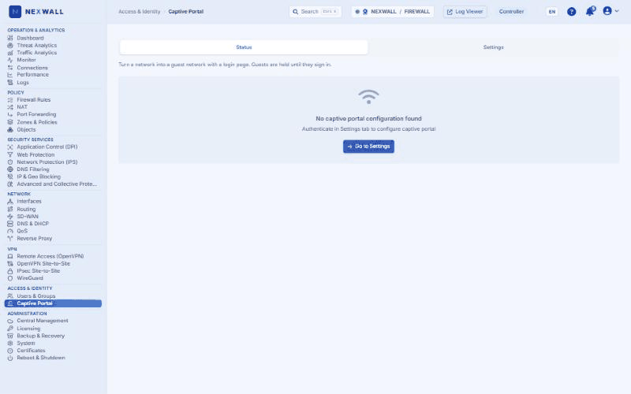

# How to turn a network into a guest network with a login page (Captive Portal)

The unit connects to a remote captive portal manager that provides the login page and the accounts. The unit enforces the access of each guest.

**Where:** **Access & Identity** > **Captive Portal**

## Before you start

- The address and an administrator account of your captive portal manager.
- A spare interface or VLAN for the guest network ([How to configure a network interface (WAN, LAN, VLAN)](../network/interface.md)).

## Steps

1. Open the page and the tab **Settings**.

   

2. Under **Login** enter the **Captive Portal manager endpoint**, the **Username** and the **Password** of the manager.
3. Under **Captive Portal configuration** type the **Captive Portal unit name** and description. Choose the **Network device** and set the **Network address** and DHCP limits (or use the default DHCP range).
4. Click **Save and commit**: the pending changes of the firewall are applied.
5. Open the tab **Status**: guest sessions appear with their MAC, IP, login status, session time and traffic.

## Check that it worked

- A guest device that connects is redirected to the login page, and after login it shows as **Authenticated**.

## If it does not work

- No device available: create the interface first (**Go to Interfaces**).
- Use **Unregister** to detach the unit from the manager.

## Related guides

- [How to configure a network interface (WAN, LAN, VLAN)](../network/interface.md)
- [How to create a zone and set its policy](../policy/zone.md)
