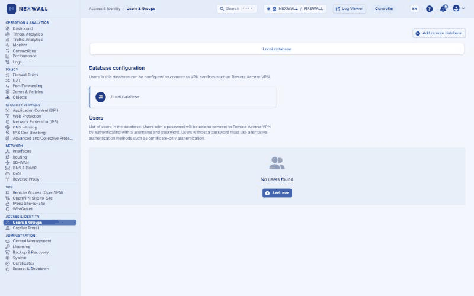

# How to create users and connect a directory (LDAP / Active Directory)

The users database is used by the VPN servers. You can keep users locally or read them from your directory.

**Where:** **Access & Identity** > **Users & Groups**

## Steps

1. Open the page.

   

2. For a local user click **Add user**, type the **Username**, the **Display name** and a strong **Password** (minimum 8 characters, upper and lower case, a number and a special character). Save.
3. To allow a user to manage the firewall use **Set as administrator user** in the row menu.
4. To read users from a directory click **Add remote database** and choose **Remote Active Directory** or **Remote LDAP (RFC 2307)**. Fill the **Database name**, the **LDAP URI**, the **Base DN**, and the **Bind DN** with its **Bind password**.
5. Click **Test**: you should see **Connection verified** and the number of users found. Save.
6. Select the database in the VPN server ([How to let users connect from home (OpenVPN remote access)](../vpn/openvpn-remote-access.md)).

## Check that it worked

- The users appear in the list. A VPN login with that user works.

## If it does not work

- Directory test fails: LDAP URI, port 636 with certificate verification, DNS and the bind account. Try `nc -vz <server> 636` on the console.

## Related guides

- [How to let users connect from home (OpenVPN remote access)](../vpn/openvpn-remote-access.md)
- [How to set up WireGuard (server with peers, or peer tunnel)](../vpn/wireguard.md)
