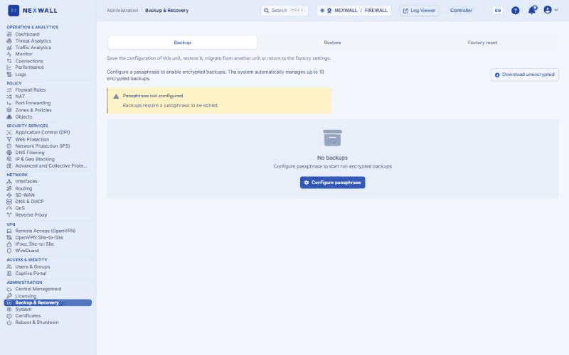

# How to back up and restore the configuration

A backup contains the whole configuration. Keep one before every change of importance.

**Where:** **Administration** > **Backup & Recovery**

## Steps

1. Open the page, tab **Backup**.

   

2. Click **Configure passphrase** and set a passphrase. Store it safely: it is required to restore.
3. Click **Download backup** to save an encrypted file on your computer, or **Run cloud backup** to send one to the cloud (subscription).
4. To restore open the tab **Restore**, choose the file (or a cloud backup), enter the passphrase and confirm. The unit reboots.
5. To move the configuration to a new unit use the tab **Migration**.

## Check that it worked

- The backup appears in **Backups** with date and size. After a restore, the rules and networks are back.

## If it does not work

- Lost passphrase: the encrypted backup cannot be opened. Keep it in the password manager.
- The tab **Factory reset** erases everything: use it only to start over.

## Related guides

- [How to update the firewall (now or scheduled)](update.md)
- [How to register the license and check the subscription](licensing.md)
