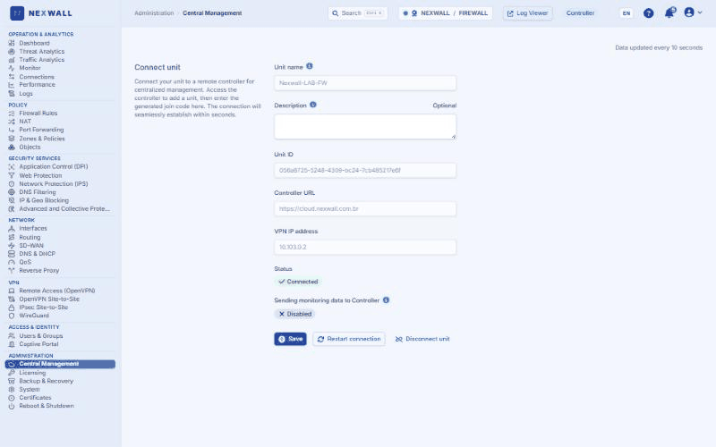

# How to connect the firewall to the Cloud Controller

Central Management connects the unit to a controller over a secure tunnel for remote access, monitoring and group management.

**Where:** **Administration** > **Central Management**

## Before you start

- The controller address and a join code generated in the controller.
- Outbound internet access from the firewall.

## Steps

1. Open the page and click **Connect unit**.

   

2. Fill the **Controller URL** and the **Controller join code**. Keep **Verify TLS certificate** on.
3. Click **Connect unit**. The state goes from **Pending** to **Connected**.
4. In the controller, the unit appears in the list with its name and VPN address.

## Check that it worked

- The page shows **Connected**, the **VPN IP address** and the last time data was sent.

## If it does not work

- Stays pending: join code expired or outbound blocked. See [Controller registration troubleshooting](../../help/controller-registration-troubleshooting.md).
- Use **Restart connection** to reconnect or **Disconnect unit** to leave the controller.

## Related guides

- [How to register the license and check the subscription](licensing.md)
