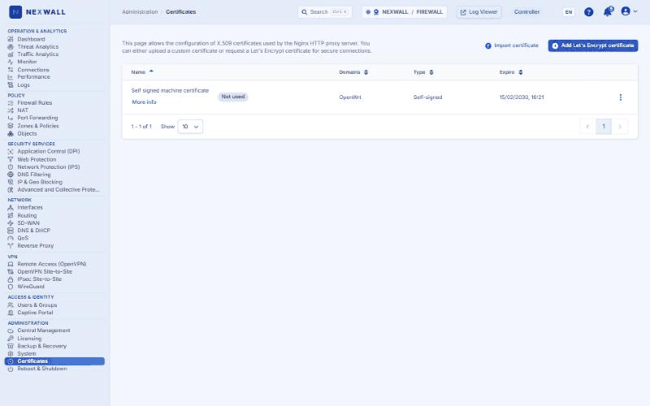

# How to install a trusted web certificate (Let's Encrypt or import)

The factory certificate is self-signed, so browsers warn. A trusted certificate removes the warning and is required for some services.

**Where:** **Administration** > **Certificates**

## Before you start

- A DNS name that points to the firewall public address (or a DNS API for validation).
- For Let's Encrypt, TCP port 80 reachable for the Standalone method.

## Steps

1. Open the page.

   

2. For Let's Encrypt click **Add Let's Encrypt certificate**: type the **Certificate name**, add the **Domain** and choose the **Validation method** (**Standalone**, **DNS** or **DNS API**). Click **Add certificate**.
3. To use your own certificate click **Import certificate**: choose the **Certificate** file, the **Private key** and, if you have it, the **Chain file**.
4. In the row of the certificate use **Set as default** to use it for the web interface.

## Check that it worked

- The certificate row shows the domains and its **Expire** date, and the browser shows the padlock.

## If it does not work

- Validation fails: port 80 blocked or the name does not point to the firewall.
- Warnings persist: [KBA-0025](../../help/kba-25-web-certificate.md).

## Related guides

- [How to publish a web application through the reverse proxy](../network/reverse-proxy.md)
- [How to set the hostname, time zone and NTP](system-settings.md)
