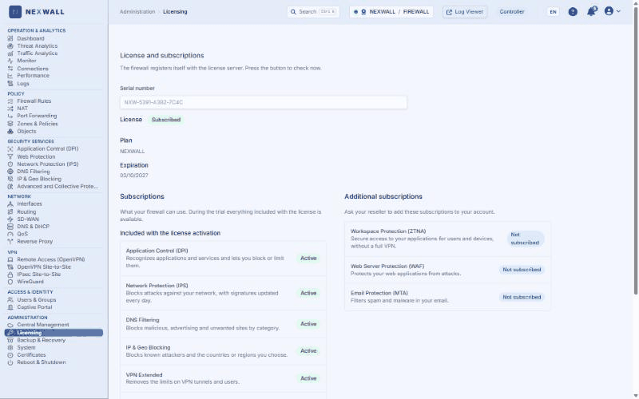

# How to register the license and check the subscription

The unit registers itself with the license server. A subscription unlocks the extended application catalog, advanced blocklists, automatic updates, remote backup and more.

**Where:** **Administration** > **Licensing**

## Steps

1. Open the page.

   

2. The page shows the **Serial number**, the **Registration** state (**Trial: \{days\} days left**, **Subscribed** or **Unlicensed (limited features)**), the **Plan** and the **Expiration**.
3. If the unit is not registered, paste the **Authentication token** you received and click **Register**.
4. Click **Sync now** to refresh the status immediately.
5. The list of features shows which ones are **Active** in your plan.

## Check that it worked

- The state is **Subscribed** and the features of the plan are active.

## If it does not work

- Not synchronising: the firewall needs outbound HTTPS. Check [KBA-0026](../../help/kba-26-licensing.md).

## Related guides

- [How to connect the firewall to the Cloud Controller](central-management.md)
- [How to update the firewall (now or scheduled)](update.md)
