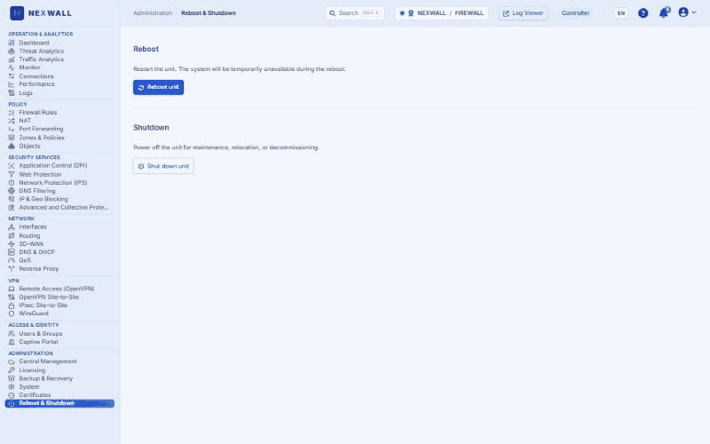

# How to reboot or shut down the firewall safely

Use the web interface instead of cutting the power: the system closes services and saves the state.

**Where:** **Administration** > **Reboot & Shutdown**

## Steps

1. Open the page.

   

2. Click **Reboot unit** to restart or **Shut down unit** to power off.
3. Read the warning. If there are unsaved changes, they will be lost: apply or discard them first.
4. Confirm with **Reboot now**. Wait for the message that the reboot is completed; the page reloads by itself.

## Check that it worked

- The dashboard shows a short **Uptime** after the reboot.

## If it does not work

- Does not come back: wait up to five minutes; if it still does not, use the console of the VM.

## Related guides

- [How to update the firewall (now or scheduled)](update.md)
- [How to back up and restore the configuration](backup-restore.md)
