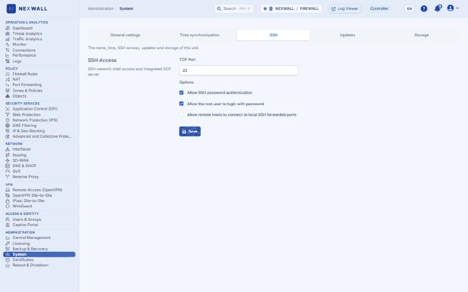

# How to manage SSH access

SSH is the door to the command line used by the KBAs. Restrict who can reach it.

**Where:** **Administration** > **System**

## Steps

1. Open **System** and choose the tab **SSH**.

   

2. Under **SSH Access** set the **TCP Port** if you want a port different from 22.
3. Decide on **Allow SSH password authentication** and **Allow the root user to login with password**. Where only trusted administrators need access, turn passwords off.
4. Save and apply. Keep your current session open and test a new one before closing it.

## Check that it worked

- `ssh root@<firewall>` on the configured port opens a shell.

## If it does not work

- Locked out: use the console of the VM or the controller remote terminal.
- SSH reachable from the internet: restrict it with an input rule ([How to allow or block traffic with a firewall rule](../policy/firewall-rule.md)).

## Related guides

- [How to set the hostname, time zone and NTP](system-settings.md)
- [How to allow or block traffic with a firewall rule](../policy/firewall-rule.md)
