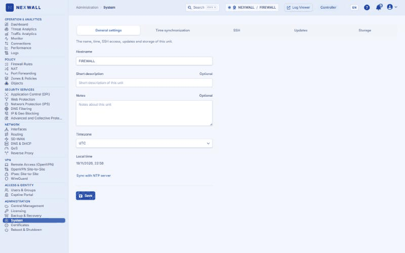

# How to set the hostname, time zone and NTP

A correct clock matters for logs, certificates, VPNs and licensing.

**Where:** **Administration** > **System**

## Steps

1. Open the page. The first tab shows **General settings**.

   

2. Type the **Hostname** and, optionally, **Notes** about the unit.
3. Choose the **Timezone**. Under **Time synchronization** keep **Enable NTP client** on and add your own **Add NTP server** if you have one.
4. To let the LAN use the firewall as time server turn on **Provide NTP server** and choose the interface.
5. Save. The tabs **SSH**, **Updates** and **Storage** are in the same page ([How to manage SSH access](ssh.md), [How to update the firewall (now or scheduled)](update.md)).

## Check that it worked

- **Local time** matches your clock.

## If it does not work

- Time wrong after a reboot: NTP blocked. Allow UDP 123 to the internet or use a local server.

## Related guides

- [How to manage SSH access](ssh.md)
- [How to update the firewall (now or scheduled)](update.md)
