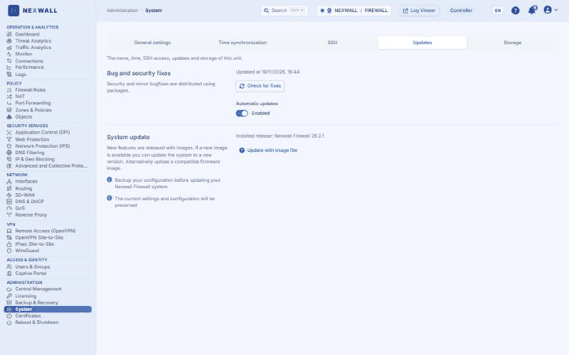

# How to update the firewall (now or scheduled)

Updates keep your configuration. Always take a backup first ([How to back up and restore the configuration](backup-restore.md)).

**Where:** **Administration** > **System**

## Steps

1. Open **System** and choose the tab **Updates**.

   

2. The page shows the **Installed release: \{release\}** and whether a new release is available. Click **Check for fixes** to refresh.
3. When **New release available** is shown, click **Update to version**. Under **Choose when to update** choose **Now** or **Schedule time and date** and pick a quiet moment.
4. Confirm with **Update and reboot**. The unit reboots; the web interface returns in a few minutes.
5. For a unit without internet use **Update with image file** and choose the image file.
6. To install fixes automatically turn on **Automatic updates**.

## Check that it worked

- The installed release is the new one, and the dashboard shows the services running.

## If it does not work

- Update fails: check space and connectivity, see [KBA-0010](../../help/kba-10-updates.md).
- After the update something is wrong: restore the backup ([How to back up and restore the configuration](backup-restore.md)).

## Related guides

- [How to back up and restore the configuration](backup-restore.md)
- [How to register the license and check the subscription](licensing.md)
