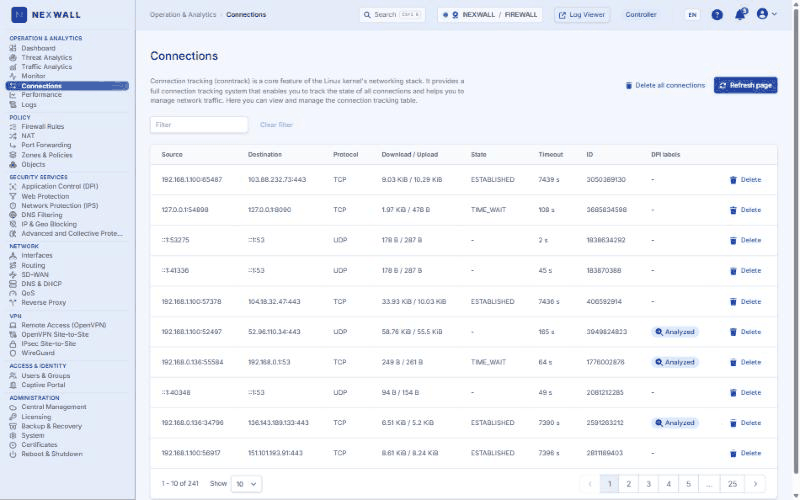

# How to see and drop active connections

The Connections page shows the connection tracking table of the kernel: every connection the firewall is following, with its state and the DPI result.

**Where:** **Operation & Analytics** > **Connections**

## Steps

1. Open **Connections**.

   

2. Read the columns **Source**, **Destination**, **Protocol**, **Download** / **Upload**, **State** and **Timeout**. The column **DPI labels** shows **Analyzed** or **Blocked**.
3. Type an address in the filter box to isolate one device or destination.
4. To end one connection click **Delete connection** on its row and confirm. The client reconnects, now under the current rules.
5. Click **Refresh page** to update the list.

## Check that it worked

- After you change a rule, deleting the old connection makes the new rule apply to it.

## If it does not work

- **Delete all connections** drops every connection, including your own session: use it only in a maintenance window.

## Related guides

- [How to see who uses the network (Traffic Analytics)](traffic-analytics.md)
- [How to allow or block traffic with a firewall rule](../policy/firewall-rule.md)
