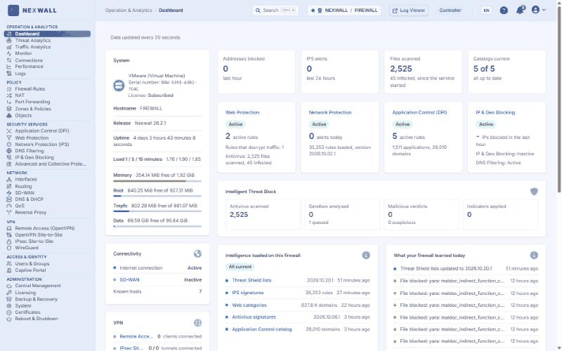

# How to read the dashboard

The dashboard is the first page after sign-in. It shows in one glance whether the unit is healthy.

**Where:** **Operation & Analytics** > **Dashboard**

## Steps

1. Open **Dashboard**.

   

2. In **System** check the **Hostname**, **Serial number**, **License**, **Release** and **Uptime**. A very short uptime means a recent reboot.
3. Look at **Load 1 / 5 / 15 minutes**: values above the number of CPU cores for long periods mean the unit is overloaded.
4. Check the status cards of the services (**SD-WAN**, **DPI-core**, **Captive Portal**, **IP & Geo Blocking**, **Remote Access VPN**): **Active**, **Inactive** or **Warning**.
5. In **WAN traffic** pick the **WAN interface** and read the **Download** and **Upload** rates.
6. Check **Memory**, **Root** and **Data**: keep them well below full.

## Check that it worked

- All services you use are **Active** and the storage is not full.

## If it does not work

- Warning about the default hostname: change it ([How to set the hostname, time zone and NTP](../admin/system-settings.md)).
- A service is **Inactive**: open its page and read the message.

## Related guides

- [How to search the logs](logs.md)
- [How to see who uses the network (Traffic Analytics)](traffic-analytics.md)
