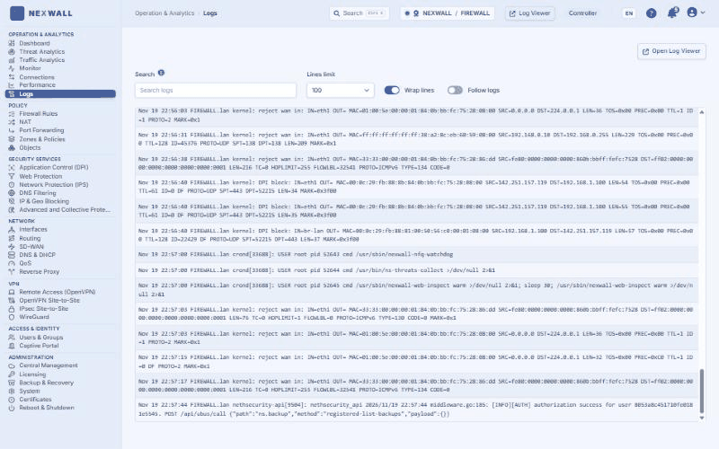

# How to search the logs

Logs are the first place to look when something does not work.

**Where:** **Operation & Analytics** > **Logs**

## Steps

1. Open **Logs** and click **Open Log Viewer**.

   

2. Set the **Lines limit** you want to see and turn **Follow logs** on to watch new lines arrive.
3. Type in **Search** a word, an IP address or a regular expression (for example `192.168.1.50|dropped`).
4. Turn **Wrap lines** on to read long lines without scrolling sideways.

## Check that it worked

- Only the lines that match your search are shown.

## If it does not work

- Message "Invalid regular expression": escape special characters such as `.` or `(`.
- No firewall events: enable logging on the rule ([How to allow or block traffic with a firewall rule](../policy/firewall-rule.md)).

## Related guides

- [How to read the dashboard](dashboard.md)
- [How to allow or block traffic with a firewall rule](../policy/firewall-rule.md)
