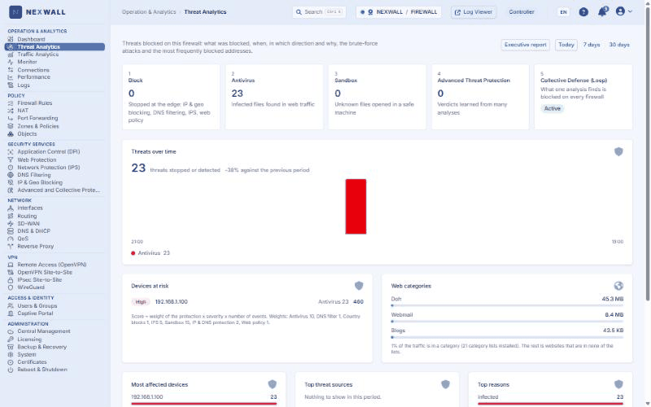

# How to review the threats stopped and the devices at risk

Threat Analytics gathers what every protection stopped or detected, so you can tell if a device needs attention.

**Where:** **Operation & Analytics** > **Threat Analytics**

## Steps

1. Open **Threat Analytics**.

   

2. Choose the period. **Threats over time** shows how many threats were stopped or detected, compared with the previous period.
3. The stages **Block**, **Antivirus**, **Sandbox** and **Advanced Threat Protection** show which protections are **Active** or **Not enabled**.
4. In **Devices at risk** see the devices with the highest score and their **Severity**.
5. At the bottom, the **Events** table lists each event; filter by **Protection** or search for a device or address.

## Check that it worked

- You can name the device with most events and the protection that stopped them.

## If it does not work

- Nothing appears: confirm the protections are on ([How to turn on intrusion prevention (IPS)](../security/ips.md), [How to block malicious domains (DNS Filtering)](../security/dns-filtering.md), [How to block bad IP addresses and countries (IP & Geo Blocking)](../security/ip-geo-blocking.md)) and that logging is enabled.

## Related guides

- [How to turn on Advanced and Collective Protection](../security/atp.md)
- [How to turn on intrusion prevention (IPS)](../security/ips.md)
- [How to see who uses the network (Traffic Analytics)](traffic-analytics.md)
