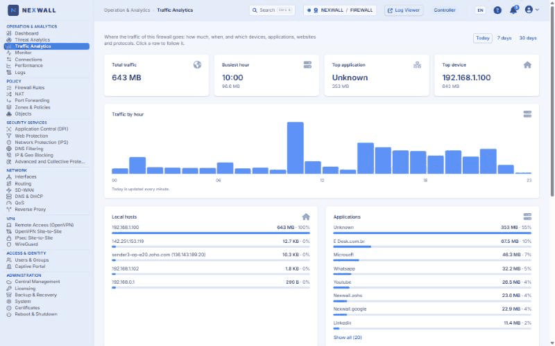

# How to see who uses the network (Traffic Analytics)

Traffic Analytics answers where the traffic goes: how much, when and which devices, applications, remote hosts and protocols.

**Where:** **Operation & Analytics** > **Traffic Analytics**

## Steps

1. Open **Traffic Analytics**.

   

2. Choose the period at the top. The cards show **Total traffic**, **Busiest hour**, **Top application** and **Top device**.
3. Below, the lists **Local hosts**, **Applications**, **Remote hosts** and **Protocols** rank the traffic.
4. Click a row to filter everything by it (for example one device) and see which applications it uses. Use **Clear** to go back.

## Check that it worked

- The charts and lists change when you select a device or application.

## If it does not work

- Empty page: the DPI engine must be active ([How to block applications and protocols (Application Control)](../security/app-control.md)). Today's data is updated every minute.

## Related guides

- [How to see and drop active connections](connections.md)
- [How to review the threats stopped and the devices at risk](threat-analytics.md)
