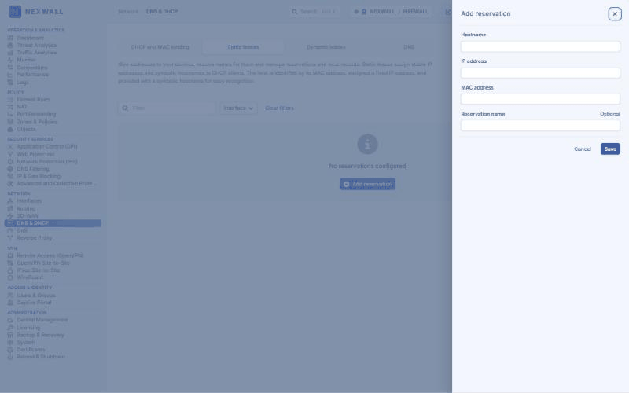

# How to reserve a fixed IP address for a device

A reservation binds a MAC address to an IP address and a host name. Servers that you publish with a port forward should have one.

**Where:** **Network** > **DNS & DHCP**

## Steps

1. Open the page and choose the tab **Static leases**.

   

2. Click **Add reservation**.
3. Fill the **Hostname**, the **IP address** (outside the dynamic range or inside it, but not used by another host) and the **MAC address**. A **Reservation name** is optional. Click **Save**.
4. To find the MAC of a connected device open the tab **Dynamic leases** or run **Scan network** in the tab **Scan network**; the result lets you reserve with one click.
5. Renew the address on the device (disconnect and reconnect the cable or run `ipconfig /renew`).

## Check that it worked

- The reservation is listed and the device receives that address.

## If it does not work

- Device keeps the old address: wait for the lease to expire or renew it on the device.
- A reservation created here also appears as a DNS name; see [How to set DNS servers and local DNS names](dns-record.md).

## Related guides

- [How to enable and tune the DHCP server](dhcp-server.md)
- [How to publish an internal server (port forward)](../policy/port-forward.md)
