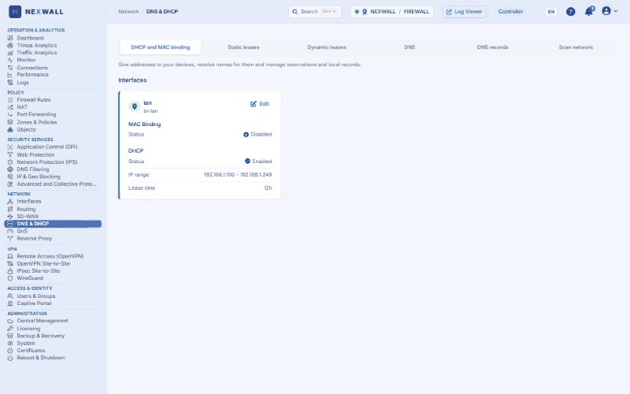

# How to enable and tune the DHCP server

The first tab, **DHCP and MAC binding**, shows each interface with its DHCP state, address range and lease time.

**Where:** **Network** > **DNS & DHCP**

## Steps

1. Open the page. On the card of the interface click **Edit \{interface\}**.

   

2. Turn on **Enable DHCP**. Fill **Range IP start** and **Range IP end** and the **Lease time**.
3. Open **Advanced settings** to set the **Gateway IP**, the **Domain** or add a **DHCP option** (for example option 66 for a provisioning server).
4. To accept only known devices turn on MAC binding and choose **Strict binding**: only hosts with a reservation get an address ([How to reserve a fixed IP address for a device](dhcp-reservation.md)). **Soft binding** allows hosts without a reservation but blocks a reserved address used by a different MAC.
5. Save.

## Check that it worked

- The card shows DHCP **Active** and the range.
- A client set to automatic address receives an address from the range. Dynamic leases are in the tab **Dynamic leases**.

## If it does not work

- No offers: confirm the interface has an address in the same network ([How to configure a network interface (WAN, LAN, VLAN)](interface.md)).
- Another DHCP server in the network: only one must answer. Use `tcpdump -ni br-lan port 67 or port 68` on the console.

## Related guides

- [How to reserve a fixed IP address for a device](dhcp-reservation.md)
- [How to set DNS servers and local DNS names](dns-record.md)
