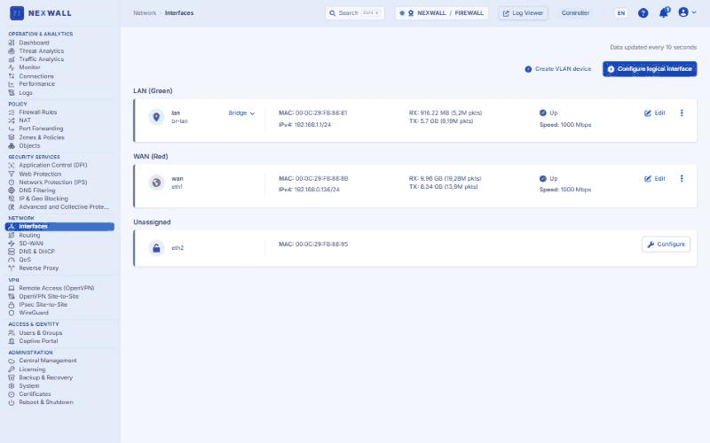

# How to configure a network interface (WAN, LAN, VLAN)

The page lists every port with its zone, MAC address, traffic counters and link speed. Unused ports appear under **Unassigned**.

**Where:** **Network** > **Interfaces**

## Before you start

- Plan the zone and the address of the new network. Create a custom zone first if needed ([How to create a zone and set its policy](../policy/zone.md)).
- Do not change the interface you are using to reach the web interface, or you lose the session.

## Steps

1. Open the page.

   

2. On an unassigned port click **Configure**. To build a bridge or use an existing device, click **Configure logical interface**.
3. Type the **Interface name** and choose the **Zone** (**LAN (Green)**, **WAN (Red)**, **GUEST (Blue)**, **DMZ (Orange)** or **Custom**).
4. Choose the **Protocol**: **Static**, DHCP client or PPPoE (then fill **Username** and **Password**).
5. For a static address fill **IPv4 address**, **IPv4 subnet mask** and, on a WAN, the **IPv4 Gateway**.
6. Save with **Configure interface**. For a VLAN click **Create VLAN device**, choose the **Base device**, the **VLAN ID** (1 to 4094) and click **Create device**; then configure the new device as above.
7. To add a second address to a port use **Create alias interface** in the ⋮ menu of the row.

## Check that it worked

- The row shows **Up** with the new address.
- Ping the new gateway from a client of the network, or use [KBA-0014](../../help/kba-14-connectivity.md).

## If it does not work

- Link shows **Down**: check the cable and the switch port; `ethtool eth2` on the console.
- Clients get no address: enable DHCP for the interface ([How to enable and tune the DHCP server](dhcp-server.md)).
- Remove the configuration of a port with **Remove configuration** in the ⋮ menu.

## Related guides

- [How to create a zone and set its policy](../policy/zone.md)
- [How to enable and tune the DHCP server](dhcp-server.md)
- [How to add a static route](route.md)
