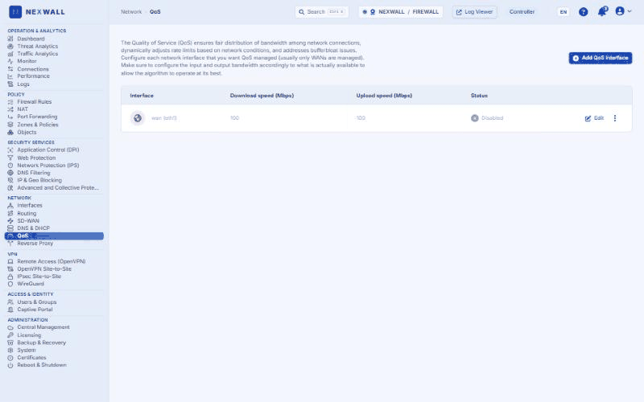

# How to limit and share bandwidth (QoS)

QoS keeps latency low when the link is full. It needs the real speed of the link.

**Where:** **Network** > **QoS**

## Before you start

- Measure the speed of the link with the **Speed test** of the dashboard or `speedtest` on the console.

## Steps

1. Open the page.

   

2. Click **Add QoS interface** (or **Edit** on the WAN row).
3. Choose the **Interface** (normally the WAN) and enter the **Download speed** and **Upload speed** in Mbps. Use about 90 to 95 percent of the measured speed.
4. Turn the **Status** on and save.

## Check that it worked

- The row shows the status **Enabled**. Run a speed test while downloading a big file: ping stays low.

## If it does not work

- Speed lower than expected: raise the values in small steps.
- A slow link with fast-path active: see [KBA-0018](../../help/kba-18-fast-path.md).

## Related guides

- [How to use two internet links (failover or load balancing)](sd-wan.md)
- [How to block applications and protocols (Application Control)](../security/app-control.md)
