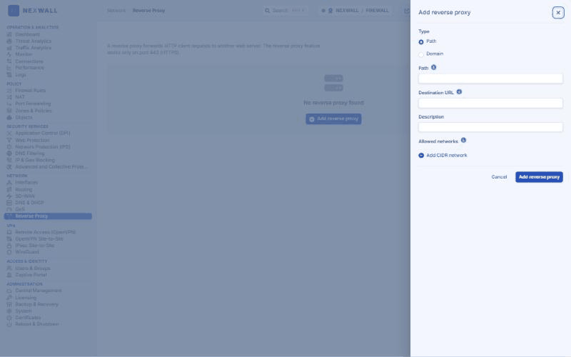

# How to publish a web application through the reverse proxy

The reverse proxy listens on TCP port 443 of the firewall and forwards requests to internal web servers, using a certificate of the firewall.

**Where:** **Network** > **Reverse Proxy**

## Before you start

- TCP port 443 must be reachable from where users come from (a rule or the **Go to firewall rules** shortcut of the page).
- If you use a domain, a trusted certificate for it ([How to install a trusted web certificate (Let's Encrypt or import)](../admin/certificate.md)).

## Steps

1. Open the page and click **Add reverse proxy**.

   

2. Choose the **Type**: **Path** (for example `/app`) or **Domain** (a host name).
3. Fill the **Destination URL**, for example `http://192.168.1.50:8080`, and a **Description**.
4. To limit who can use it click **Add CIDR network** and enter the allowed networks. Choose the **Certificate** when the type is domain.
5. Click **Add reverse proxy**.

## Check that it worked

- Open `https://<firewall-address>/app` from an allowed network and the application loads.

## If it does not work

- Timeout from outside: port 443 not open, see the notice at the top of the page.
- Application with absolute links does not work under a path: use a domain.

## Related guides

- [How to install a trusted web certificate (Let's Encrypt or import)](../admin/certificate.md)
- [How to publish an internal server (port forward)](../policy/port-forward.md)
