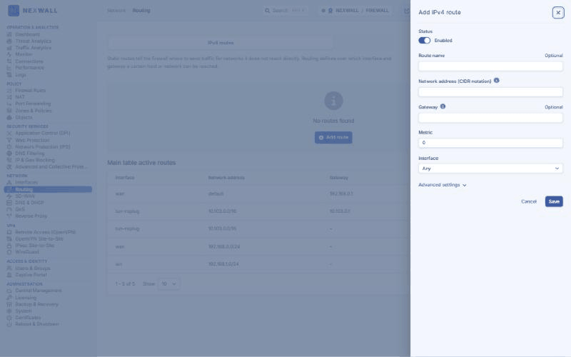

# How to add a static route

Use a static route when another router connects a remote network, for example a branch reachable through a LAN router.

**Where:** **Network** > **Routing**

## Before you start

- Know the remote network (CIDR) and the gateway on a network the firewall already reaches.

## Steps

1. Open the page and click **Add route** under the tab **IPv4 routes**.

   

2. Fill **Route name** (optional) and **Network address (CIDR notation)**, for example `10.20.0.0/24`.
3. Fill the **Gateway** with the address of the next router and choose the **Interface** or leave it on Any.
4. Set the **Metric** if there is more than one route to the same network (lower wins). Click **Save**.
5. Create a [How to allow or block traffic with a firewall rule](../policy/firewall-rule.md) if the traffic crosses zones.

## Check that it worked

- The route appears in **Main table active routes**.
- From a LAN client, `ping` a host in the remote network.

## If it does not work

- Route not used: the gateway must be on a directly connected network.
- Replies do not return: the remote host needs a route back to your LAN.

## Related guides

- [How to configure a network interface (WAN, LAN, VLAN)](interface.md)
- [How to allow or block traffic with a firewall rule](../policy/firewall-rule.md)
