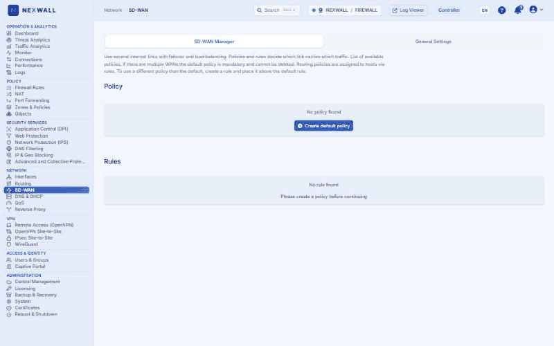

# How to use two internet links (failover or load balancing)

With two or more WAN links the SD-WAN manager decides which link carries which traffic. A default policy is mandatory.

**Where:** **Network** > **SD-WAN**

## Before you start

- Both WAN ports are configured as interfaces in the WAN zone ([How to configure a network interface (WAN, LAN, VLAN)](interface.md)).

## Steps

1. Open the page.

   

2. Click **Create default policy**. Under **Choose behavior** choose **Backup** (one link in use, the other waits) or **Balance** (both in use).
3. Add each gateway with **Add Gateway**. In backup mode order them by priority; in balance mode set the **Weight** of each.
4. Open the tab **General Settings**. Under **WAN monitoring** add reliable addresses to ping, for example `1.1.1.1` and `8.8.8.8`. Adjust **Ping settings** only if needed.
5. To send specific traffic through a specific link click **Create new rule**: name it, choose the **Assigned policy**, and the source, destination, protocol and ports. Rules are checked in order; the default policy is last.

## Check that it worked

- The policy shows both links up. Unplug the primary: the traffic switches within the detection time, and the event is in **Logs**.

## If it does not work

- Links flap: the monitoring address may block ping. Use two different addresses.
- Sessions break on balance: use **Sticky** on the rule for sites that bind the session to the source address.

## Related guides

- [How to configure a network interface (WAN, LAN, VLAN)](interface.md)
- [How to read the dashboard](../monitor/dashboard.md)
