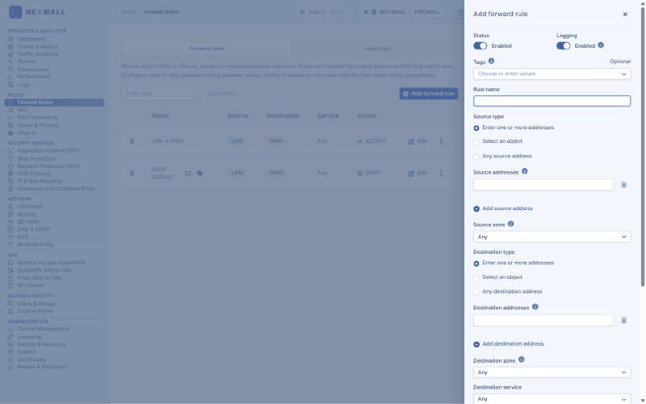

# How to allow or block traffic with a firewall rule

Firewall rules decide which traffic is accepted, dropped or rejected. Rules are checked from top to bottom and the first match wins, so position matters.

**Where:** **Policy** > **Firewall Rules**

## Before you start

- Know the **source zone** and **destination zone** of the traffic (see [How to create a zone and set its policy](zone.md)).
- Decide the action: **Accept** lets it through, **Drop** discards it silently, **Reject** discards it and tells the sender.

## Steps

1. Open the page and choose the tab: **Forward rules** (traffic between zones), **Input rules** (traffic to the firewall itself) or **Output rules** (traffic the firewall starts).
2. Click **Add forward rule** (or the input/output button of the tab). A panel opens at the right.

   

3. Type a **Rule name** that says what the rule does, for example `LAN to servers HTTPS`.
4. Under **Source type** enter the addresses, pick an object or choose **Any source address**. Select the **Source zone**.
5. Do the same for the destination: **Destination type** and **Destination zone**.
6. Choose the **Service**. Use **Custom service** to enter **Protocols** and **Ports**, for example `8081, 9090, 5500-5600`.
7. Choose the **Action**.
8. Set the **Rule position**: **Add to the top** or **Add to the bottom**. A specific rule that must win over a general one goes above it.
9. Leave **Logging** on for rules you want to audit. Click **Save rule**.
10. To change the order later, drag the handle at the left of the row. Use the ⋮ menu to **Duplicate** or **Delete rule** a rule.

## Check that it worked

- The rule appears in the list and the **Rules at a glance** panel counts it.
- Test from a client in the source zone. The log of the rule (**Logs**) shows the match when logging is on.

## If it does not work

- The rule shows as **Inactive**: it uses a zone that no longer exists, or it was disabled. Edit it and choose a valid zone.
- Traffic still blocked: a rule above yours matches first. Move yours up.
- Site unreachable from a client: [KBA-0004](../../help/kba-04-site-unreachable.md).

## Related guides

- [How to create a zone and set its policy](zone.md)
- [How to create reusable objects (host sets and domain sets)](object.md)
- [How to publish an internal server (port forward)](port-forward.md)
