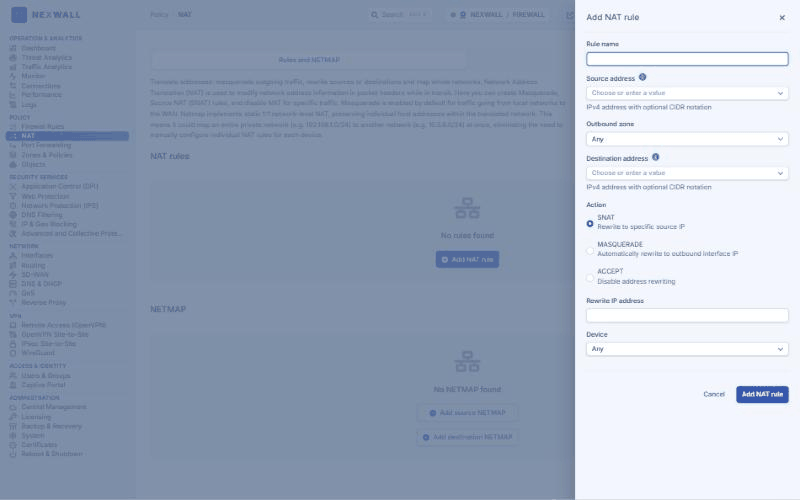

# How to create a NAT rule (masquerade or source NAT)

Masquerade is already active for the LAN. Create a NAT rule when you need a fixed source address, a different address per network, or no translation (for example between two sites over a tunnel).

**Where:** **Policy** > **NAT**

## Before you start

- Know the source network, the outbound zone and, for source NAT, the public address to use.

## Steps

1. Open the page and click **Add NAT rule**.

   

2. Type the **Rule name**.
3. Fill **Source address** and **Destination address** (IPv4 with optional CIDR) or leave **Any address**. Choose the **Outbound zone**.
4. Choose the **Action**: **Automatically rewrite to outbound interface IP**; **Rewrite to specific source IP** (then enter the **Rewrite IP address**); or **Disable address rewriting**.
5. Click **Save NAT rule**.

## Check that it worked

- The rule is listed. On the console, `nft list ruleset | grep -i snat` or the connection list (**Connections**) shows the translated source.

## If it does not work

- Traffic between sites must not be translated: add an **Disable address rewriting** rule above the masquerade.
- Same addresses at both sites: use NETMAP (tab **Rules and NETMAP**).

## Related guides

- [How to allow or block traffic with a firewall rule](firewall-rule.md)
- [How to build an IPsec tunnel to another firewall or router](../vpn/ipsec-site-to-site.md)
