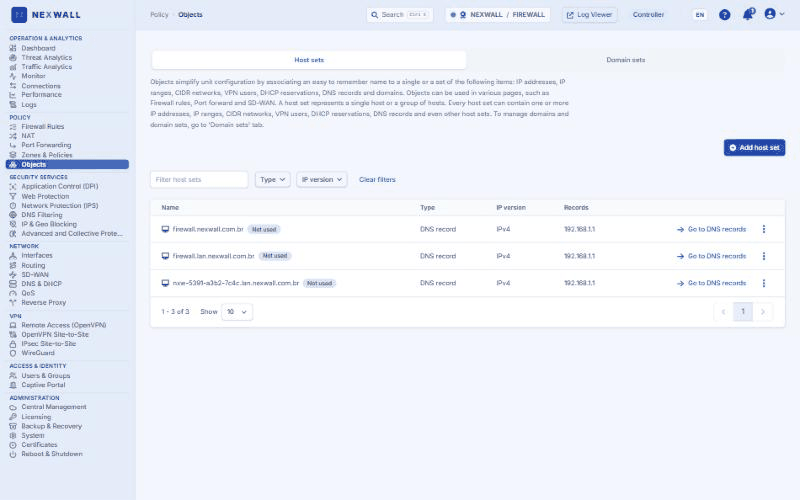

# How to create reusable objects (host sets and domain sets)

Objects make rules readable and easy to maintain: change the object and every rule that uses it follows.

**Where:** **Policy** > **Objects**

## Steps

1. Open the page. Choose the tab **Host sets** or **Domain sets**.

   

2. Click **Add host set** (or **Add domain set**). Type a **Name** with letters and numbers only.
3. For a host set choose the **IP version** and click **Add record** for each item: **Host**, **CIDR network**, **IP range**, **DHCP reservation** or **DNS record**. For a domain set use **Add domain**.
4. Click **Save host set** (or **Save domain set**).
5. Use the object in a rule: in the source or destination choose **Select an object**.

## Check that it worked

- The object is listed. **Show usages** lists where it is used.

## If it does not work

- Cannot delete: the object is in use. Remove it from the rules listed in the usages first.
- Port forwards do not accept IP ranges or nested objects.

## Related guides

- [How to allow or block traffic with a firewall rule](firewall-rule.md)
- [How to publish an internal server (port forward)](port-forward.md)
