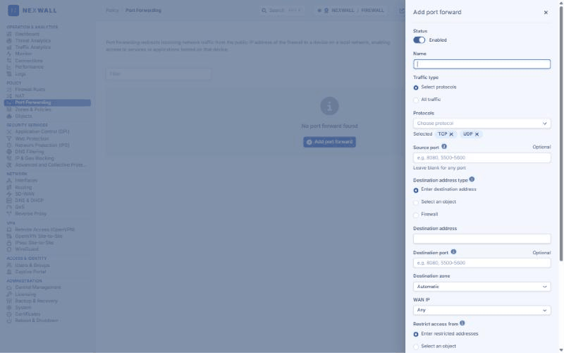

# How to publish an internal server (port forward)

A port forward publishes a service, such as a web server, that runs on an internal host, using the public address of the firewall.

**Where:** **Policy** > **Port Forwarding**

## Before you start

- The internal server has a fixed address (use a DHCP reservation, see [How to reserve a fixed IP address for a device](../network/dhcp-reservation.md)).
- Know the port clients will use and the port of the server.

## Steps

1. Open the page and click **Add port forward**. A panel opens.

   

2. Type a **Name**, for example `Web server`.
3. Under **Traffic type** keep **Select protocols** and mark TCP, UDP or both under **Protocols**. Avoid **All traffic**: it sends everything to one host.
4. Enter the **Source port** that clients connect to, for example `8080` or `5500-5600`.
5. Under **Destination address type** enter the internal host address, or pick an object. Optionally set the **Destination port**; if empty, the same port is used.
6. Choose the **Destination zone** (**Automatic** works for most cases) and the **WAN IP** if you have more than one.
7. To allow only some clients, fill **Restrict access from** with addresses or networks. By default anyone can connect.
8. Enable **Hairpin NAT** zones if internal users must reach the service using the public name. Click **Save port forward**.

## Check that it worked

- The row shows **Enabled**.
- From the internet, connect to the public address and port. Test from a mobile network, not from inside your LAN.

## If it does not work

- Works from outside but not from the LAN: enable **Hairpin NAT** for the LAN zone.
- No answer: the server firewall or its gateway. The server must use the firewall as default gateway.
- Check the path with [KBA-14](../../help/kba-14-connectivity.md).

## Related guides

- [How to allow or block traffic with a firewall rule](firewall-rule.md)
- [How to create reusable objects (host sets and domain sets)](object.md)
