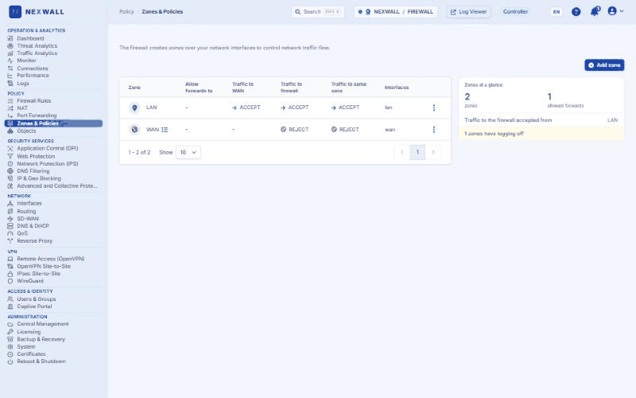

# How to create a zone and set its policy

A zone is a group of network interfaces with the same trust level (LAN, WAN, Guest, DMZ). The zone policy says which zones may send traffic to which.

**Where:** **Policy** > **Zones & Policies**

## Before you start

- The interface of the new network exists (see [How to configure a network interface (WAN, LAN, VLAN)](../network/interface.md)).

## Steps

1. Open the page. The matrix shows each zone with **Allow forwards to**, **Traffic to WAN**, **Traffic to firewall** and **Traffic to same zone**.

   

2. Click **Add zone**. Choose a preset (**Guest** or **DMZ**) to get a safe starting policy, or type a **Name**.
3. Select the **Interfaces** that belong to the zone.
4. Under **Allow forwards to** choose the zones it may reach. Allow **Traffic to firewall** only for zones that need the web interface, DNS or DHCP of the firewall.
5. Keep **Logging** on and save.

## Check that it worked

- The zone is listed with its colour and the **Zones at a glance** panel counts it.
- A client in the zone gets an address and only reaches what you allowed.

## If it does not work

- Guests reach the LAN: remove the LAN from **Allow forwards to** of the Guest zone.
- For one exception, use a [How to allow or block traffic with a firewall rule](firewall-rule.md) rather than opening the whole zone.

## Related guides

- [How to allow or block traffic with a firewall rule](firewall-rule.md)
- [How to configure a network interface (WAN, LAN, VLAN)](../network/interface.md)
