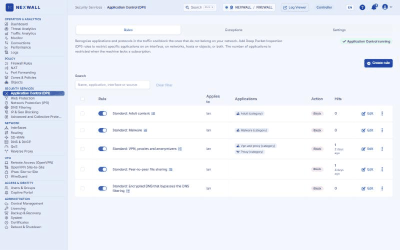

# How to block applications and protocols (Application Control)

Application Control identifies applications by deep packet inspection (DPI) and blocks the ones you choose, even when they use common ports.

**Where:** **Security Services** > **Application Control (DPI)**

## Before you start

- An active subscription for the full application catalog (the page marks items **Available with subscription**).
- Know the interface or network the rule applies to.

## Steps

1. Open the page. In the tab **Rules** click **Create rule**.

   

2. Choose the **Interface** (**Any interface** or one) and, in **Applies to**, add the networks, hosts or objects. Empty means **All hosts on the interface**.
3. In **Apps and protocols to block** search by name or category and select each app or protocol to block. The counter shows how many are selected.
4. Turn on **Enable rule** and click **Save rule**.
5. To let one host bypass the rules open the tab **Exceptions**, click **Add exception**, enter the **Exception name** and the **IP address**.

## Check that it worked

- The rule lists **Blocked apps and protocols**. Try the app from a client: it fails. Blocked connections appear in **Logs** and **Threat Analytics**.

## If it does not work

- An app is not blocked: it may be encrypted with a new version. Update the catalog (**Settings**) and see [KBA-22](../../help/kba-22-unknown-applications.md).
- Unwanted slowness: [KBA-19](../../help/kba-19-inspection-settings.md) and [KBA-21](../../help/kba-21-dpi-engine-stall.md).

## Related guides

- [How to filter web sites by category (Web Protection)](web-protection.md)
- [How to turn on intrusion prevention (IPS)](ips.md)
