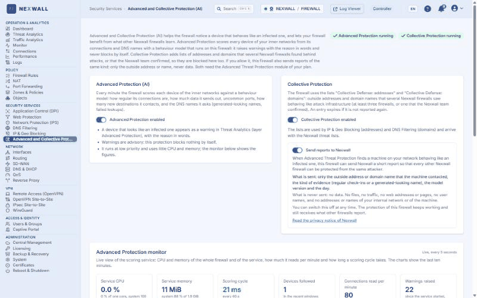

# How to turn on Advanced and Collective Protection

Advanced Protection (AI) warns about devices that behave like infected ones. Collective Protection adds lists of addresses and domains learned from other Nexwall firewalls.

**Where:** **Security Services** > **Advanced and Collective Protection (AI)**

## Before you start

- A plan that includes the Advanced Threat Protection module (see [How to register the license and check the subscription](../admin/licensing.md)).

## Steps

1. Open the page.

   

2. Under **Advanced Protection (AI)** turn on **Advanced Protection enabled**. The protection only warns in **Threat Analytics**; it blocks nothing by itself.
3. Under **Collective Protection** turn on **Collective Protection enabled**. The shared lists are used by IP & Geo Blocking and DNS Filtering, so both must be on ([How to block bad IP addresses and countries (IP & Geo Blocking)](ip-geo-blocking.md), [How to block malicious domains (DNS Filtering)](dns-filtering.md)).
4. Decide on **Send reports to Nexwall**. Only the outside address or domain name is sent; no files, traffic or user data.
5. Save and apply. The **Advanced Protection monitor** shows the service CPU, memory and warnings raised.

## Check that it worked

- The monitor shows the scoring cycle running and the number of devices followed.

## If it does not work

- "Not included in your plan": check **Licensing**.
- Service not running: restart it from the console and see [KBA-0016](../../help/kba-16-services.md).

## Related guides

- [How to block bad IP addresses and countries (IP & Geo Blocking)](ip-geo-blocking.md)
- [How to review the threats stopped and the devices at risk](../monitor/threat-analytics.md)
