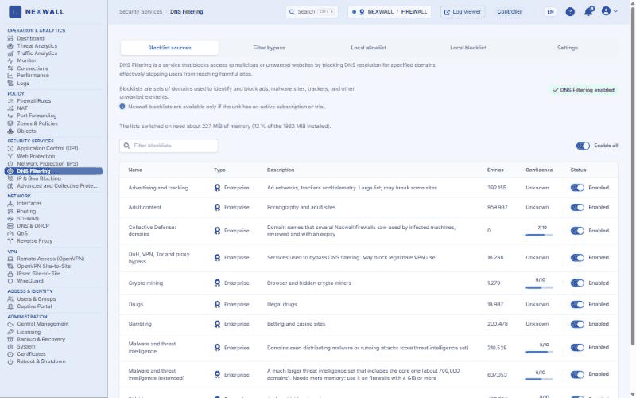

# How to block malicious domains (DNS Filtering)

DNS Filtering stops clients from resolving known malicious domains using blocklists that are updated automatically.

**Where:** **Security Services** > **DNS Filtering**

## Before you start

- Clients use the firewall as DNS server ([How to enable and tune the DHCP server](../network/dhcp-server.md)).

## Steps

1. Open the page and choose the tab **Settings**.

   

2. Turn on **DNS Filtering enabled**. Choose the **Force DNS redirection on these zones** where DNS requests must be redirected to the firewall, even when a client has its own DNS configured.
3. In the tab **Blocklist sources** switch on the lists you want. Watch the memory notice: big lists need memory.
4. To block one more domain open **Local blocklist** and click **Add domain**. To always allow a domain use **Local allowlist**.
5. To exempt a client use **Filter bypass** and **Add bypass**.

## Check that it worked

- `nslookup` of a blocked domain does not return the real address. Blocks are listed in **Threat Analytics**.

## If it does not work

- A good site is blocked: add its domain to the local allowlist.
- Lists do not load: [KBA-0023](../../help/kba-23-threat-shield-troubleshooting.md) and [KBA-0024](../../help/kba-24-threat-shield-lists.md).

## Related guides

- [How to block bad IP addresses and countries (IP & Geo Blocking)](ip-geo-blocking.md)
- [How to set DNS servers and local DNS names](../network/dns-record.md)
