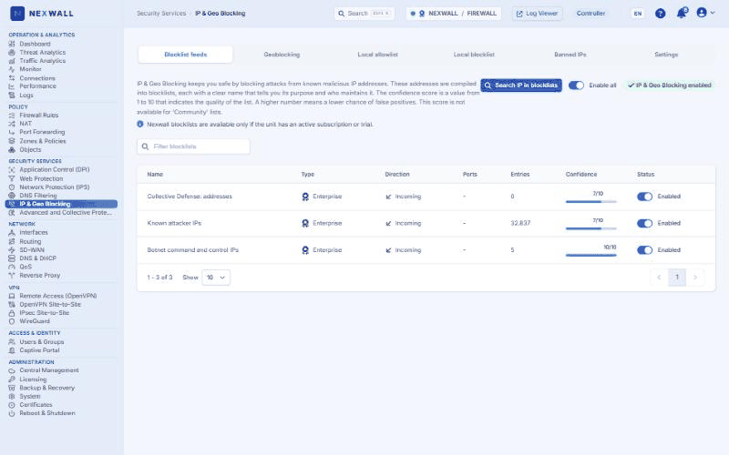

# How to block bad IP addresses and countries (IP & Geo Blocking)

IP & Geo Blocking drops traffic to and from addresses with a bad reputation, by feed or by country, before it reaches your rules.

**Where:** **Security Services** > **IP & Geo Blocking**

## Steps

1. Open the page and choose the tab **Settings**.

   

2. Turn on **IP & Geo Blocking enabled**. Set the options: **Logging** of blocked packets and **Block brute force attacks**.
3. In the tab **Blocklist feeds** switch on the feeds you want. Each feed shows its **Direction** and **Confidence**.
4. To block whole countries from reaching the firewall itself open the tab **Geoblocking** and mark the **Blocked countries**. Banned addresses (brute force) are listed in **Banned IPs**.
5. To block a single address open **Local blocklist** and click **Add address**. To protect a partner address from blocks use **Local allowlist**.
6. Save and apply.

## Check that it worked

- Blocked packets are counted and, if logging is on, written to the log.

## If it does not work

- A partner cannot connect: add its address to the local allowlist.
- Feeds not updating: [KBA-24](../../help/kba-24-threat-shield-lists.md).

## Related guides

- [How to block malicious domains (DNS Filtering)](dns-filtering.md)
- [How to allow or block traffic with a firewall rule](../policy/firewall-rule.md)
