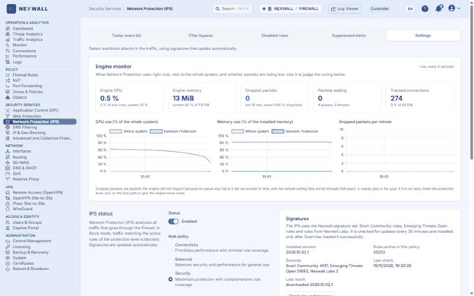

# How to turn on intrusion prevention (IPS)

The IPS inspects traffic for attacks. Start with the balanced policy and raise it only if you need to.

**Where:** **Security Services** > **Network Protection (IPS)**

## Before you start

- An active subscription (the page reports if the license is missing).
- Enough memory: see [KBA-20](../../help/kba-20-throughput-sizing.md).

## Steps

1. Open the page and choose the tab **Settings**.

   

2. Turn on **IPS enabled**. If the page shows **IPS is disabled**, use **Go to Settings**.
3. Choose the **Rule policy**: **Connectivity** (fewest false positives), **Balanced** (recommended) or **Security** (strictest).
4. Check that the signatures are updated in **Signatures**; click **Check for updates now** if needed.
5. Save and apply. For a trusted address that raises false alarms open the tab **Filter bypass** and click **Add bypass**.

## Check that it worked

- The tab **Today event list** lists events of the day. IPS status shows it is running.

## If it does not work

- Throughput dropped: [KBA-19](../../help/kba-19-inspection-settings.md) and [KBA-20](../../help/kba-20-throughput-sizing.md).
- A legitimate service blocked: find the rule in the event list and use **Disabled rules** or the bypass.

## Related guides

- [How to block applications and protocols (Application Control)](app-control.md)
- [How to review the threats stopped and the devices at risk](../monitor/threat-analytics.md)
