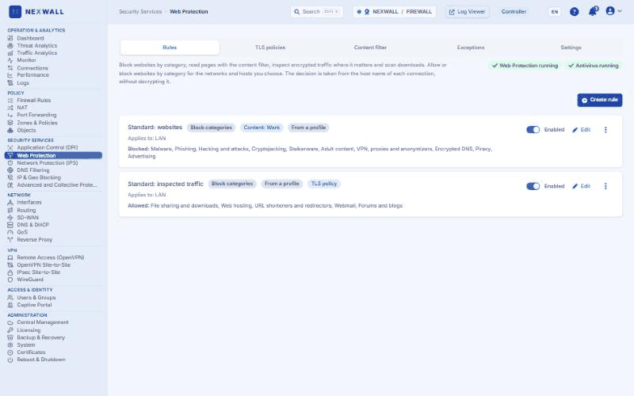

# How to filter web sites by category (Web Protection)

Web Protection filters HTTP and HTTPS by category. With SSL inspection the categories are applied to encrypted pages; without it only the host name is used.

**Where:** **Security Services** > **Web Protection**

## Before you start

- A subscription that includes Web Protection.
- For full HTTPS filtering, the firewall certificate installed on the clients ([How to install a trusted web certificate (Let's Encrypt or import)](../admin/certificate.md)).

## Steps

1. Open the page and, in the tab **Settings**, turn on **Enable Web Protection** if it is off.

   

2. Go to the tab **Rules** and click **Create rule**.
3. Type the **Rule name** and choose the **Zones** and, optionally, the **Networks, hosts and objects** (networks, hosts and objects).
4. Choose the mode: **Block categories** (block the categories you mark) or **Allow list** (only the marked categories are allowed).
5. Mark each category as **Allowed** or **Blocked**. Use **Search categories** to find them. Choose the **TLS policy** and turn on **Enable the rule**. Save.
6. To exempt a host or site use the tab **Exceptions**.

## Check that it worked

- A blocked category shows the block page in the browser.
- The rule appears in the list; the category catalog is current in **Category lists**.

## If it does not work

- Certificate warning on HTTPS sites: install the firewall CA on the client or exempt the site.
- A site is miscategorised: add an exception and report it to Nexwall.

## Related guides

- [How to block malicious domains (DNS Filtering)](dns-filtering.md)
- [How to block applications and protocols (Application Control)](app-control.md)
