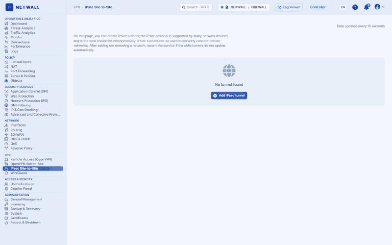

# How to build an IPsec tunnel to another firewall or router

IPsec (IKEv2) is the standard choice to connect to a router or firewall of another brand.

**Where:** **VPN** > **IPsec Site-to-Site**

## Before you start

- The public address of the other end and its identifier (if any).
- The remote and local networks, which must not overlap, and the same pre-shared key and encryption settings on both ends.

## Steps

1. Open the page and click **Add IPsec tunnel**.

   

2. Type the **Tunnel name**. Choose the WAN with **Choose WAN** and enter the **Remote IP address**.
3. Add the **Local networks** and **Remote networks** with **Add network**.
4. Under **Pre-shared key** use **Use generated key** (copy it to the other end) or **Use custom key**. Set the local and remote identifier only if the other side requires it.
5. Open **Phase 1 (IKE)** and the phase 2 section and match the algorithms, lifetimes and DPD of the other end. Save.
6. Create the firewall rules between the LAN and VPN zones ([How to allow or block traffic with a firewall rule](../policy/firewall-rule.md)) and exempt the tunnel traffic from NAT ([How to create a NAT rule (masquerade or source NAT)](../policy/nat-rule.md)).

## Check that it worked

- The tunnel row shows **Connected**, with the child SA **Installed**. On the console, `swanctl --list-sas` shows ESTABLISHED.

## If it does not work

- Never leaves the connecting state: wrong key, identifiers or proposals. Compare both ends, and look at the log: `grep charon /var/log/messages`.
- Up but no traffic: rules, NAT or routes. See [KBA-06](../../help/kba-06-vpn.md).

## Related guides

- [How to connect two offices with OpenVPN (site-to-site)](openvpn-site-to-site.md)
- [How to create a NAT rule (masquerade or source NAT)](../policy/nat-rule.md)
