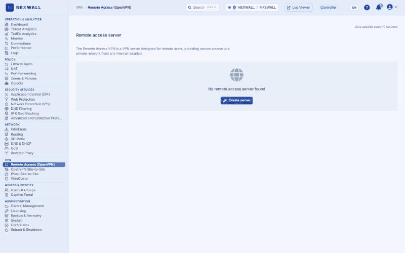

# How to let users connect from home (OpenVPN remote access)

Remote Access (OpenVPN) lets laptops and phones connect securely to your networks from anywhere.

**Where:** **VPN** > **Remote Access (OpenVPN)**

## Before you start

- The firewall WAN address or a DNS name that points to it ([How to install a trusted web certificate (Let's Encrypt or import)](../admin/certificate.md) if you want a trusted web certificate).
- Users exist in the local database or a directory ([How to create users and connect a directory (LDAP / Active Directory)](../access/user.md)).
- A WAN address reachable from the internet: the VPN port (UDP 1194 by default) must reach the firewall.

## Steps

1. Open the page and click **Create server**.

   

2. Type the **Server name**. Choose the **User database** and the **Authentication mode** (**Username and password**, **Certificate** or with OTP).
3. Choose the **Mode**: **Routed** (recommended) with a **VPN network** that does not overlap your LAN, for example `10.8.0.0/24`.
4. Add the **Public IP/hostname of this unit**. Keep the **Protocol** **UDP** and the default **Port** unless a network blocks it.
5. Choose what the clients reach: **Push network routes** (only the networks you add) or **Route all client traffic through VPN**.
6. Click **Create**. Then open the tab **Remote access accounts**, create the accounts (or **Create an account for each user**) and use **Download configuration** for each user.
7. Give the user the file to import into an OpenVPN client.

## Check that it worked

- **Connected clients** lists the user after connecting. The user reaches an internal address.

## If it does not work

- Client cannot connect: the port is not open on the WAN or a router in front blocks it. Test from outside the LAN.
- Connected but cannot reach the LAN: add the network under **Push network routes** and create a [How to allow or block traffic with a firewall rule](../policy/firewall-rule.md) from the VPN zone.
- See [KBA-0006](../../help/kba-06-vpn.md).

## Related guides

- [How to create users and connect a directory (LDAP / Active Directory)](../access/user.md)
- [How to set up WireGuard (server with peers, or peer tunnel)](wireguard.md)
- [How to allow or block traffic with a firewall rule](../policy/firewall-rule.md)
