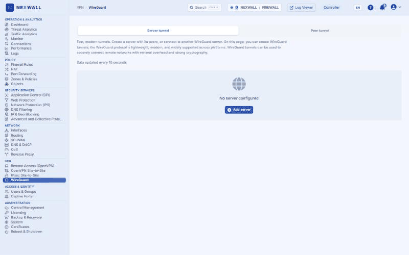

# How to set up WireGuard (server with peers, or peer tunnel)

WireGuard is fast and simple. A server tunnel serves many peers; a peer tunnel connects this firewall to another WireGuard server.

**Where:** **VPN** > **WireGuard**

## Steps

1. Open the page. For users choose the tab **Server tunnel** and click **Add server**.

   

2. Type the **Name**, the **VPN network** (for example `10.9.0.0/24`), the **UDP port** and the **Public Endpoint** of the firewall. Add the **Server networks** that peers may reach and, if needed, the **DNS servers**. Save.
3. In the server row click **Add peer**: type the **Name** of the peer, choose **Route all traffic** if all traffic must go through the VPN, and save.
4. Give the peer the configuration: **Download configuration** or **Download QR code** to scan with the phone app.
5. To connect this firewall to another WireGuard server use the tab **Peer tunnel**: **Add peer tunnel** or **Import peer tunnel** with a configuration file.
6. Create the firewall rules between the zones ([How to allow or block traffic with a firewall rule](../policy/firewall-rule.md)).

## Check that it worked

- The peer shows a recent handshake (**Connection**). From the peer, ping an internal address.

## If it does not work

- No handshake: the UDP port is not reachable or the keys do not match.
- Handshake but no traffic: rules or the allowed networks of the peer.
- See [KBA-06](../../help/kba-06-vpn.md).

## Related guides

- [How to let users connect from home (OpenVPN remote access)](openvpn-remote-access.md)
- [How to allow or block traffic with a firewall rule](../policy/firewall-rule.md)
