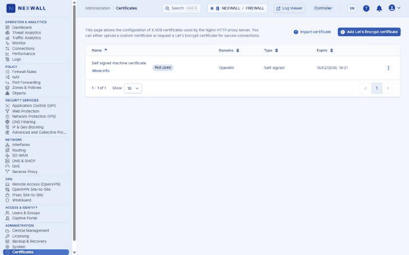

# Certificates

**Administration > Certificates** manages the X.509 certificates that the web server of the unit uses. This covers the
web interface and the [reverse proxy](../network/reverse-proxy.md).

*Certificates: the machine certificate and the buttons to import or request one.*

**On this screen**

- The list shows each certificate with its domains, type and expiry date. **Not used** means no service uses it yet.
- **Import certificate** uploads your own; **Add Let's Encrypt certificate** requests a free one for a public name.
- The first row is the self-signed certificate the firewall creates for itself.

## The default certificate

A new unit uses a self-signed certificate, which browsers do not trust. You can keep using it inside a small network, but
for anything else, replace it.

## Getting a certificate

| Method | When to use it |
|---|---|
| Upload | You already have a certificate, its private key and its chain from a certification authority |
| Let's Encrypt | You want a free certificate that renews itself |

### Let's Encrypt

The unit requests a certificate for one or more names and renews it before it expires. The name must resolve to the
unit, and one of two validation methods must work:

- **Standalone (HTTP):** the authority connects to the unit on port 80. Port 80 must be reachable from the internet.
- **DNS:** the unit proves ownership by creating a record in your DNS zone. It needs no inbound port and it can issue
  **wildcard** certificates. Choose your DNS provider and enter the access data it requires.

## Using a certificate

Mark one certificate as the **default**. It is served when someone reaches the unit by its fully qualified domain name.
Other certificates are selected in the reverse proxy rules.

## Deleting

Deleting a certificate is irreversible. Make sure nothing uses it first.

## Related pages

- [Reverse proxy](../network/reverse-proxy.md)
- [System](system.md)
