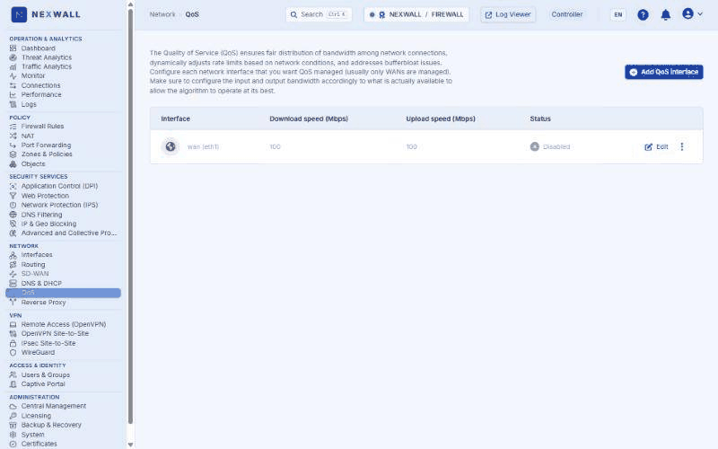

# Quality of service (QoS)

**Network > QoS** keeps your internet link responsive when it is busy. The unit distributes the available bandwidth
fairly among connections, adjusts limits according to network conditions, and reduces **bufferbloat**: the delay that
appears when a saturated link queues too many packets.

*QoS: choose the interfaces to manage and the real bandwidth of each.*

**On this screen**

- Each row is one interface (normally a WAN) with its **download** and **upload** speed in Mbps.
- Enter the speed your provider really delivers, a little below the contract is safest.
- **Add QoS interface** adds another link; **Edit** turns QoS on or off for a row.

## Configuring an interface

QoS is configured for each WAN interface.

1. Measure the real speed of the link with a speed test, in both directions.
2. Enable QoS for the interface.
3. Enter the **download** speed (incoming) and the **upload** speed (outgoing), in Mbit per second.
4. Save and **Apply changes**.

:::tip Enter a little less than the measurement
Enter a value 5 to 10 percent below what you measured. This leaves headroom so that the queue stays in the unit, which
is where it can be managed, and not at your provider.
:::

## When to use it

- Video calls or voice stutter while someone downloads a large file.
- Web pages load slowly when the link is saturated.
- You share a link among many users and want fairness.

## Related pages

- [SD-WAN](sd-wan.md)
- [Performance](../operation-analytics/performance.md)
