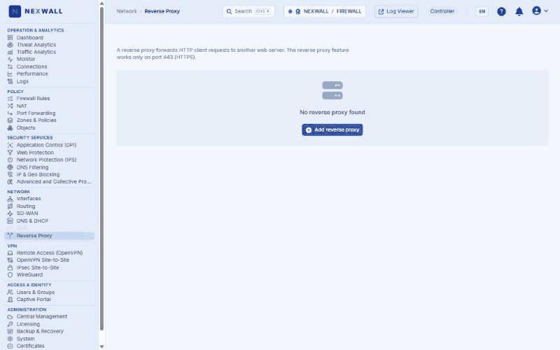

# Reverse proxy

**Network > Reverse Proxy** publishes web applications that live on your internal network. Visitors connect to the
firewall over HTTPS, and the firewall forwards their requests to the internal server. This lets you publish several
sites behind one public address and terminate encryption in one place.

*Reverse proxy: empty list with the Add reverse proxy button.*

**On this screen**

- The list shows every published site. A new firewall has none.
- **Add reverse proxy** publishes an internal web server through the firewall.
- The feature works only on port 443 (HTTPS), so it needs a certificate (see Certificates).

The reverse proxy works **only on TCP port 443 (HTTPS)**.

## Requirements

- TCP port 443 must be open and reachable on the WAN. If it is not, the page tells you and asks you to check your rules
  in [Firewall rules](../policy/firewall-rules.md).
- A valid certificate for the names you publish. Configure certificates in
  [Certificates](../infrastructure/certificates.md); the page reminds you when none is configured.

## Creating a rule

| Field | Meaning |
|---|---|
| Match | A **site name** (a fully qualified domain name) or a **resource path** that starts with `/` |
| Destination | The internal address to forward to, for example `http://server:8080/app` |
| Certificate | The certificate presented to visitors |
| Allowed networks | Optional. Only these IPv4 or IPv6 networks can use the rule |

Rules that match a site name are used for whole sites. Rules that match a path publish one part of a site.

## Tips

- Restrict administrative applications with **Allowed networks**.
- Test with a browser from outside, and check the [Logs](../operation-analytics/logs.md) if a rule does not answer.
- Remember that the firewall web interface also uses port 443. A published name must not clash with the name that
  reaches the firewall itself.

## Related pages

- [NAT and port forwarding](../policy/nat-port-forwarding.md) for services that are not HTTPS
