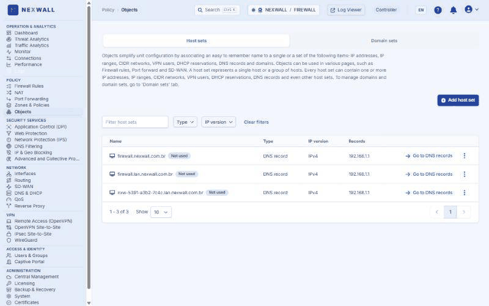

# Objects

**Policy > Objects** lets you give a name to a set of addresses or domains and use that name wherever the interface asks
for them. When you change the object, every rule that uses it follows automatically.

*Objects: host sets and domain sets with their usage.*

**On this screen**

- The **Host sets** tab lists named groups of addresses, ranges, networks, VPN users and DNS records.
- The **Domain sets** tab does the same for domains.
- The badge next to a name shows whether the object is **in use**; an unused object can be removed safely.

## Host sets

A host set is one host or a group of hosts. Each entry in it can be:

- an IP address, a network in CIDR notation, or an IP range;
- a DHCP reservation;
- a DNS record;
- a VPN user;
- another host set.

Every host set has an **IP family**, IPv4 or IPv6, and all entries must match it.

Host sets are used in firewall rules, in SD-WAN rules and in other pages that accept addresses.

## Domain sets

A domain set is a domain or a group of domains, for example the sites of a video service. Use one in a rule to allow or
block traffic to those domains. The domains are resolved to addresses, and you choose whether to resolve them to IPv4 or
IPv6 addresses, according to what the rule needs.

## Where an object is used

The page shows where each object is used. An object that is in use cannot be deleted; remove it from the places that
use it first.

## Limits

- Host sets that contain IP ranges, or that contain other objects, cannot be used in port forwards. The page tells you
  which port forward uses the set.
- Names must be made of letters, numbers and simple separators.

## Related pages

- [Firewall rules](firewall-rules.md)
- [NAT and port forwarding](nat-port-forwarding.md)
