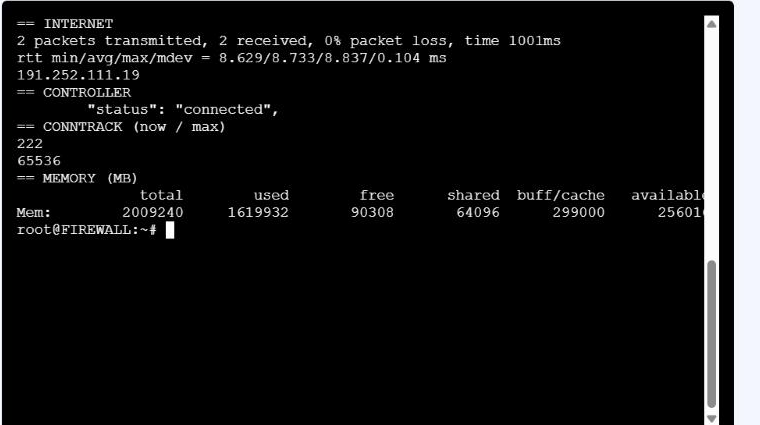

# KBA-01: Chequeo de salud en 5 minutos

**Síntoma.** Algo falla y no sabe por dónde empezar, o quiere confirmar que la unidad está sana después de un cambio.

**Aplica a.** Nexwall Firewall 26.2.1. Solo lectura: nada de esto cambia la configuración. Ejecute como `root` por SSH, consola o terminal remota del controlador.

## Ejecútelo

Pegue el bloque completo. Tarda unos cinco segundos.

```sh
echo "== TIME"; date; uptime
echo "== DISK"; df -h / /mnt/data 2>/dev/null
echo "== MEMORY (MB)"; free -m | head -2
echo "== LINKS"; ip -br a
echo "== DEFAULT ROUTE"; ip route | grep default
echo "== INTERNET"; ping -c2 -W2 8.8.8.8 | tail -2
echo "== DNS"; dig +short +time=3 +tries=1 nexwall.com.br
echo "== CONTROLLER"; ubus call ns.plug status | grep '"status"'
echo "== CONNTRACK (now / max)"; conntrack -C; cat /proc/sys/net/netfilter/nf_conntrack_max
echo "== CRITICAL ERRORS"; grep -iE 'out of memory|oom|segfault|panic' /var/log/messages | tail -3
```

Ejemplo de salida de una unidad sana:



## Cómo leer el resultado

| Sección | Sano | Si no |
|---|---|---|
| `DISK` | `/` por debajo de 85% usado | Limpie logs y respaldos antiguos; vea [Logs](../operation-analytics/logs.md). Un disco lleno detiene servicios. |
| `MEMORY` | `available` es más del 10% de `total` | Fuga o demasiadas funciones en una unidad pequeña. Vea [Rendimiento](../operation-analytics/performance.md). |
| `LINKS` | WAN y LAN en `UP` con dirección | WAN sin dirección: vaya a [KBA-03](kba-03-no-internet.md). |
| `DEFAULT ROUTE` | Una línea `default via` por WAN | Ausente: la WAN no recibió gateway. [KBA-03](kba-03-no-internet.md). |
| `INTERNET` | 0% de pérdida | Pérdida o sin respuesta: [KBA-03](kba-03-no-internet.md). |
| `DNS` | Se imprime una dirección IP | Vacío: [KBA-05](kba-05-dns.md). |
| `CONTROLLER` | `"status": "connected"` | Sin conexión: [Registro en el controlador](controller-registration-troubleshooting.md). |
| `CONNTRACK` | "now" muy por debajo de "max" | Cerca del máximo: un cliente inunda conexiones; ubíquelo en [Conexiones](../operation-analytics/monitor-connections.md). |
| `CRITICAL ERRORS` | No se imprime nada | Lea las líneas y envíelas con el [paquete de soporte](kba-17-support-package.md). |

## Siguiente paso

¿Todo sano y el problema continúa? Probablemente es un solo servicio o un solo destino: use [KBA-16](kba-16-services.md). ¿Duda? Recoja el [paquete de soporte (KBA-17)](kba-17-support-package.md).
